# EEG emotion calibration and explanation experiment

## Abstract

This automatically generated report summarizes the completed artifacts for 32 LOSO target folds, with 0 failed folds. It evaluates the specified DEAP calibration protocol and reports unavailable analyses explicitly. A result is not treated as evidence when its corresponding CSV contains no measured rows.

## Research question

Does subject-specific calibration make EEG emotion explanations more faithful and stable to the model's actual decision process while maintaining predictive performance?

> **Headline findings (descriptive):** folds completed 32/32; L0 general BA 0.4948; L4 shrinkage_brier BA 0.4832; paired mean BA change -0.0117; compact faithfulness L0/L4 0.6697/0.7702; L4 refit cosine 0.3939. Replication: does not replicate all approximate reference metrics within the stated ±0.05 diagnostic tolerance. Interpret only alongside the paired intervals and availability table below.

## Run and data protocol

The input workbook was `dataset\Metadata\participant_ratings.xls`. Reference rows were joined to video-order signal trials, checked against stored dominance and liking, and sorted into presentation order. Per target, trials 1–20 are calibration and 21–40 are held-out test. The test labels are used only for evaluation and descriptive test-only lambda curves. LOSO source subjects and each subject’s first 20 unlabeled features fit preprocessing. Seed is 42; n_jobs is 1.

L1/L2 bug investigation: the previous runner passed the already normalized 4-second feature dictionary to both rungs, which made L2 a no-op relative to L1. The current runner retains raw L1 features and separately derives L2 by per-subject z-scoring from trials 1–20 before source correlation filtering and scaling. Tests assert the L2 features differ and that calibration means and standard deviations are approximately 0 and 1. The feature cache is at `cache`; entries are keyed by subject signal-file hashes. Available cached subjects are reused, and only missing cache entries are extracted.

## Methods

- **L0:** full stimulus log band powers, correlation filtering, source scaling and grouped logistic model selection.
- **L1:** 2/4/8-second stimulus windows, artifact rejection, and robust median aggregation; no baseline samples.
- **L2:** L1 features normalized independently for each subject from its first 20 presentation-order trials.
- **L3:** MI ranking within an sklearn pipeline, recomputed inside GroupKFold training folds, with k selected from the configured grid. Random-k and correlation-only controls are reported.
- **L4:** L3 features with source-to-calibration coefficient shrinkage. Lambda is selected using pseudo-target calibration/validation within source subjects. The test-only lambda sweep is descriptive and is not used for selection. Per-fold preprocessing is reused for pseudo-target models, which introduces the documented small optimism in the pseudo-target score.

The mixing comparator applies 10x calibration weights relative to source weights, fixes class factors from source labels, and normalizes total weight to the source sample count. The intercept-only comparator freezes source coefficients and fits only the intercept on balanced calibration log-loss. Exact additive linear explanations use source-background means in transformed feature space. All models are evaluated on the same high-valence log-odds quantity. Faithfulness uses independent channel masks (p=.25) and top-five compact predictions. Stability uses stratified source/calibration bootstrap refits. The exploratory section is excluded from the main claim.

## Results

L0 general mean balanced accuracy: **0.4948**. L4 shrinkage_brier mean balanced accuracy: **0.4832**. Difference: **-0.0117**. L0 general compact faithfulness: **0.6697**; L4 shrinkage_brier compact faithfulness: **0.7702**. L4 shrinkage_brier refit cosine stability: **0.3939**. Missing or NaN values are not substituted. See `replication_diff.md` for the line-item audit and post-fix metric check.

Notebook replication check (warning threshold: absolute difference > 0.05): mix10 balanced accuracy: observed 0.4891, approximate reference 0.56; mix10 compact faithfulness: observed 0.6873, approximate reference 0.60

Pseudo-target selection results: shrinkage_brier=32/32 selected infinity, shrinkage_ba=19/32 selected infinity, shrinkage_finite=0/32 selected infinity. Infinity returns the source model, so those selections do not adapt coefficients on the target.

The one-sided 95% lower bound for the L4 shrinkage minus L0 general BA difference is -0.0476; the pre-chosen illustrative margin is -0.03; preserved=False.

### Metrics by rung and model

| arm | model | n | balanced_accuracy | compact_faithfulness | macro_f1 | roc_auc | brier | log_loss | deletion_auc |
| --- | --- | --- | --- | --- | --- | --- | --- | --- | --- |
| L0 | general | 32 | 0.49483 | 0.66967 | 0.35896 | 0.46801 | 0.26560 | 0.72855 | 0.27115 |
| L0 | intercept_only | 32 | 0.46702 | 0.66967 | 0.44592 | 0.46801 | 0.25573 | 0.70535 | 0.27115 |
| L0 | majority | 32 | 0.50000 | - | 0.35393 | 0.50000 | 0.44062 | 7.10204 | - |
| L0 | mix10 | 32 | 0.48907 | 0.68729 | 0.36988 | 0.47933 | 0.26658 | 0.73049 | 0.30877 |
| L0 | shrinkage_brier | 32 | 0.49483 | 0.66967 | 0.35896 | 0.46801 | 0.26560 | 0.72855 | 0.27115 |
| L0 | target_only | 32 | 0.52121 | 0.67235 | 0.49894 | 0.50726 | 0.25426 | 0.70437 | 0.12927 |
| L1 | general | 32 | 0.49562 | 0.65911 | 0.34483 | 0.49193 | 0.27236 | 0.74872 | 0.29805 |
| L1 | intercept_only | 32 | 0.48372 | 0.65911 | 0.46217 | 0.49193 | 0.25319 | 0.69980 | 0.29805 |
| L1 | majority | 32 | 0.50000 | - | 0.35393 | 0.50000 | 0.44062 | 7.10204 | - |
| L1 | mix10 | 32 | 0.47957 | 0.66208 | 0.36547 | 0.46021 | 0.26403 | 0.72335 | 0.32628 |
| L1 | shrinkage_brier | 32 | 0.49562 | 0.65911 | 0.34483 | 0.49193 | 0.27236 | 0.74872 | 0.29805 |
| L1 | target_only | 32 | 0.51526 | 0.71657 | 0.48928 | 0.49550 | 0.25583 | 0.70645 | 0.22403 |
| L2 | general | 32 | 0.47898 | 0.53203 | 0.45916 | 0.50464 | 0.26768 | 0.73411 | 0.36008 |
| L2 | intercept_only | 32 | 0.48977 | 0.53203 | 0.46890 | 0.50464 | 0.26737 | 0.73355 | 0.36008 |
| L2 | majority | 32 | 0.50000 | - | 0.35393 | 0.50000 | 0.44062 | 7.10204 | - |
| L2 | mix10 | 32 | 0.47409 | 0.58803 | 0.45291 | 0.47885 | 0.29593 | 0.82016 | 0.44951 |
| L2 | shrinkage_brier | 32 | 0.47898 | 0.53203 | 0.45916 | 0.50464 | 0.26768 | 0.73411 | 0.36008 |
| L2 | target_only | 32 | 0.50008 | 0.63387 | 0.47379 | 0.49981 | 0.29922 | 0.91356 | 0.29139 |
| L3 | general | 32 | 0.48317 | 0.77016 | 0.46176 | 0.49423 | 0.26396 | 0.72561 | 0.23293 |
| L3 | intercept_only | 32 | 0.48548 | 0.77016 | 0.46505 | 0.49423 | 0.26416 | 0.72604 | 0.23293 |
| L3 | majority | 32 | 0.50000 | - | 0.35393 | 0.50000 | 0.44062 | 7.10204 | - |
| L3 | mix10 | 32 | 0.47815 | 0.79279 | 0.45158 | 0.48747 | 0.27936 | 0.76753 | 0.30562 |
| L3 | shrinkage_brier | 32 | 0.48317 | 0.77016 | 0.46176 | 0.49423 | 0.26396 | 0.72561 | 0.23293 |
| L3 | target_only | 32 | 0.49561 | 0.82280 | 0.47254 | 0.49585 | 0.30567 | 0.94528 | 0.42722 |
| L4 | general | 32 | 0.48317 | 0.77016 | 0.46176 | 0.49423 | 0.26396 | 0.72561 | 0.23293 |
| L4 | intercept_only | 32 | 0.48548 | 0.77016 | 0.46505 | 0.49423 | 0.26416 | 0.72604 | 0.23293 |
| L4 | majority | 32 | 0.50000 | - | 0.35393 | 0.50000 | 0.44062 | 7.10204 | - |
| L4 | mix10 | 32 | 0.47815 | 0.79279 | 0.45158 | 0.48747 | 0.27936 | 0.76753 | 0.30562 |
| L4 | shrinkage_ba | 32 | 0.49133 | 0.77308 | 0.46853 | 0.49697 | 0.26429 | 0.72660 | 0.23510 |
| L4 | shrinkage_brier | 32 | 0.48317 | 0.77016 | 0.46176 | 0.49423 | 0.26396 | 0.72561 | 0.23293 |
| L4 | shrinkage_finite | 32 | 0.49165 | 0.76773 | 0.46569 | 0.49542 | 0.26416 | 0.72623 | 0.23450 |
| L4 | target_only | 32 | 0.49561 | 0.82280 | 0.47254 | 0.49585 | 0.30567 | 0.94528 | 0.42722 |

### Paired statistics

The table contains subject-averaged paired mean changes, paired bootstrap intervals, sign-flip tests, Wilcoxon checks, counts, and endpoint-wise Holm-adjusted p-values. Quick runs use the configured quick resample count; full runs use 20,000 resamples.

- Final vs baseline balanced accuracy: mean delta -0.0117 (95% CI -0.0547, +0.0329; sign-flip p=0.6093; Holm across primary endpoints p=1.0000); the paired 95% interval includes zero.
- Final vs baseline compact faithfulness: mean delta +0.1005 (95% CI +0.0441, +0.1562; sign-flip p=0.0021; Holm across primary endpoints p=0.0064); the paired 95% interval is above zero.
- Personalized vs general refit stability: mean delta +0.0000 (95% CI +0.0000, +0.0000; sign-flip p=1.0000; Holm across primary endpoints p=1.0000); the paired 95% interval includes zero.

| comparison | endpoint | n | mean_delta | ci_low | ci_high | signflip_p | wilcoxon_p | improved | tied | degraded | holm_p | holm_primary_endpoints |
| --- | --- | --- | --- | --- | --- | --- | --- | --- | --- | --- | --- | --- |
| L1 general - L0 general | balanced_accuracy | 32 | 0.00079 | -0.01971 | 0.02259 | 0.94605 | 0.91651 | 7 | 19 | 6 | 1.00000 | - |
| L2 general - L0 general | balanced_accuracy | 32 | -0.01585 | -0.06839 | 0.03607 | 0.56317 | 0.69590 | 13 | 2 | 17 | 1.00000 | - |
| L3 general - L0 general | balanced_accuracy | 32 | -0.01166 | -0.05466 | 0.03294 | 0.60932 | 0.54387 | 14 | 2 | 16 | 1.00000 | - |
| L4 general - L0 general | balanced_accuracy | 32 | -0.01166 | -0.05466 | 0.03294 | 0.60932 | 0.54387 | 14 | 2 | 16 | 1.00000 | - |
| L0 mix10 - L0 general | balanced_accuracy | 32 | -0.00576 | -0.03579 | 0.02571 | 0.72851 | 0.53271 | 9 | 13 | 10 | 1.00000 | - |
| L0 target_only - L0 general | balanced_accuracy | 32 | 0.02637 | -0.01580 | 0.06739 | 0.22244 | 0.23270 | 18 | 2 | 12 | 1.00000 | - |
| L0 intercept_only - L0 general | balanced_accuracy | 32 | -0.02781 | -0.05938 | 0.00367 | 0.10084 | 0.10948 | 11 | 6 | 15 | 1.00000 | - |
| L0 shrinkage_brier - L0 general | balanced_accuracy | 32 | 0.00000 | 0.00000 | 0.00000 | 1.00000 | 1.00000 | 0 | 32 | 0 | 1.00000 | - |
| L1 mix10 - L1 general | balanced_accuracy | 32 | -0.01605 | -0.04900 | 0.01483 | 0.32918 | 0.42082 | 9 | 13 | 10 | 1.00000 | - |
| L1 target_only - L1 general | balanced_accuracy | 32 | 0.01964 | -0.01810 | 0.05784 | 0.33023 | 0.34682 | 18 | 3 | 11 | 1.00000 | - |
| L1 intercept_only - L1 general | balanced_accuracy | 32 | -0.01190 | -0.05026 | 0.02561 | 0.55057 | 0.62154 | 14 | 2 | 16 | 1.00000 | - |
| L1 shrinkage_brier - L1 general | balanced_accuracy | 32 | 0.00000 | 0.00000 | 0.00000 | 1.00000 | 1.00000 | 0 | 32 | 0 | 1.00000 | - |
| L2 mix10 - L2 general | balanced_accuracy | 32 | -0.00489 | -0.04233 | 0.03489 | 0.80841 | 0.66538 | 11 | 3 | 18 | 1.00000 | - |
| L2 target_only - L2 general | balanced_accuracy | 32 | 0.02110 | -0.03390 | 0.07581 | 0.45598 | 0.56310 | 19 | 1 | 12 | 1.00000 | - |
| L2 intercept_only - L2 general | balanced_accuracy | 32 | 0.01079 | -0.00447 | 0.02895 | 0.24504 | 0.26203 | 6 | 24 | 2 | 1.00000 | - |
| L2 shrinkage_brier - L2 general | balanced_accuracy | 32 | 0.00000 | 0.00000 | 0.00000 | 1.00000 | 1.00000 | 0 | 32 | 0 | 1.00000 | - |
| L3 mix10 - L3 general | balanced_accuracy | 32 | -0.00502 | -0.04478 | 0.03401 | 0.81311 | 0.95460 | 15 | 4 | 13 | 1.00000 | - |
| L3 target_only - L3 general | balanced_accuracy | 32 | 0.01244 | -0.03832 | 0.06323 | 0.64117 | 0.49271 | 17 | 1 | 14 | 1.00000 | - |
| L3 intercept_only - L3 general | balanced_accuracy | 32 | 0.00231 | -0.00909 | 0.01521 | 0.75626 | 0.95935 | 5 | 22 | 5 | 1.00000 | - |
| L3 shrinkage_brier - L3 general | balanced_accuracy | 32 | 0.00000 | 0.00000 | 0.00000 | 1.00000 | 1.00000 | 0 | 32 | 0 | 1.00000 | - |
| L4 mix10 - L4 general | balanced_accuracy | 32 | -0.00502 | -0.04478 | 0.03401 | 0.81311 | 0.95460 | 15 | 4 | 13 | 1.00000 | - |
| L4 target_only - L4 general | balanced_accuracy | 32 | 0.01244 | -0.03832 | 0.06323 | 0.64117 | 0.49271 | 17 | 1 | 14 | 1.00000 | - |
| L4 intercept_only - L4 general | balanced_accuracy | 32 | 0.00231 | -0.00909 | 0.01521 | 0.75626 | 0.95935 | 5 | 22 | 5 | 1.00000 | - |
| L4 shrinkage_brier - L4 general | balanced_accuracy | 32 | 0.00000 | 0.00000 | 0.00000 | 1.00000 | 1.00000 | 0 | 32 | 0 | 1.00000 | - |
| L4 shrinkage_ba - L4 general | balanced_accuracy | 32 | 0.00816 | -0.00520 | 0.02292 | 0.29604 | 0.23672 | 5 | 25 | 2 | 1.00000 | - |
| L4 shrinkage_finite - L4 general | balanced_accuracy | 32 | 0.00848 | -0.00951 | 0.02659 | 0.37898 | 0.47756 | 9 | 17 | 6 | 1.00000 | - |
| L4 shrinkage_brier - L0 general | balanced_accuracy | 32 | -0.01166 | -0.05466 | 0.03294 | 0.60932 | 0.54387 | 14 | 2 | 16 | 1.00000 | 1.00000 |
| L4 shrinkage_brier - L4 mix10 | balanced_accuracy | 32 | 0.00502 | -0.03401 | 0.04478 | 0.81311 | 0.95460 | 13 | 4 | 15 | 1.00000 | - |
| L4 shrinkage_ba - L4 shrinkage_brier | balanced_accuracy | 32 | 0.00816 | -0.00520 | 0.02292 | 0.29604 | 0.23672 | 5 | 25 | 2 | 1.00000 | - |
| L4 shrinkage_finite - L4 shrinkage_brier | balanced_accuracy | 32 | 0.00848 | -0.00951 | 0.02659 | 0.37898 | 0.47756 | 9 | 17 | 6 | 1.00000 | - |
| L1 general - L0 general | compact_faithfulness | 32 | -0.01056 | -0.04637 | 0.02536 | 0.57422 | 0.59877 | 14 | 0 | 18 | 1.00000 | - |
| L2 general - L0 general | compact_faithfulness | 32 | -0.13764 | -0.17925 | -0.09810 | 0.00005 | 0.00000 | 2 | 0 | 30 | 0.00165 | - |
| L3 general - L0 general | compact_faithfulness | 32 | 0.10050 | 0.04410 | 0.15623 | 0.00215 | 0.00471 | 20 | 0 | 12 | 0.05590 | - |
| L4 general - L0 general | compact_faithfulness | 32 | 0.10050 | 0.04410 | 0.15623 | 0.00215 | 0.00471 | 20 | 0 | 12 | 0.05590 | - |
| L0 mix10 - L0 general | compact_faithfulness | 32 | 0.01762 | -0.02694 | 0.06240 | 0.45428 | 0.45404 | 18 | 0 | 14 | 1.00000 | - |
| L0 target_only - L0 general | compact_faithfulness | 32 | 0.00268 | -0.05583 | 0.05884 | 0.92860 | 0.71902 | 17 | 0 | 15 | 1.00000 | - |
| L0 intercept_only - L0 general | compact_faithfulness | 32 | -0.00000 | -0.00000 | 0.00000 | 1.00000 | 1.00000 | 4 | 23 | 5 | 1.00000 | - |
| L0 shrinkage_brier - L0 general | compact_faithfulness | 32 | 0.00000 | 0.00000 | 0.00000 | 1.00000 | 1.00000 | 0 | 32 | 0 | 1.00000 | - |
| L1 mix10 - L1 general | compact_faithfulness | 32 | 0.00297 | -0.04664 | 0.05368 | 0.90730 | 0.90460 | 17 | 0 | 15 | 1.00000 | - |
| L1 target_only - L1 general | compact_faithfulness | 32 | 0.05746 | 0.01010 | 0.10595 | 0.02485 | 0.04977 | 21 | 0 | 11 | 0.54667 | - |
| L1 intercept_only - L1 general | compact_faithfulness | 32 | 0.00000 | -0.00000 | 0.00000 | 1.00000 | 1.00000 | 5 | 21 | 6 | 1.00000 | - |
| L1 shrinkage_brier - L1 general | compact_faithfulness | 32 | 0.00000 | 0.00000 | 0.00000 | 1.00000 | 1.00000 | 0 | 32 | 0 | 1.00000 | - |
| L2 mix10 - L2 general | compact_faithfulness | 32 | 0.05600 | 0.02665 | 0.08636 | 0.00115 | 0.00133 | 25 | 0 | 7 | 0.03335 | - |
| L2 target_only - L2 general | compact_faithfulness | 32 | 0.10184 | 0.05416 | 0.15011 | 0.00040 | 0.00036 | 24 | 0 | 8 | 0.01200 | - |
| L2 intercept_only - L2 general | compact_faithfulness | 32 | -0.00000 | -0.00000 | 0.00000 | 0.72731 | 1.00000 | 3 | 24 | 5 | 1.00000 | - |
| L2 shrinkage_brier - L2 general | compact_faithfulness | 32 | 0.00000 | 0.00000 | 0.00000 | 1.00000 | 1.00000 | 0 | 32 | 0 | 1.00000 | - |
| L3 mix10 - L3 general | compact_faithfulness | 32 | 0.02263 | 0.00316 | 0.04147 | 0.02995 | 0.03412 | 22 | 0 | 10 | 0.62892 | - |
| L3 target_only - L3 general | compact_faithfulness | 32 | 0.05264 | 0.02200 | 0.08414 | 0.00180 | 0.00223 | 23 | 0 | 9 | 0.05040 | - |
| L3 intercept_only - L3 general | compact_faithfulness | 32 | 0.00000 | 0.00000 | 0.00000 | 0.49598 | 1.00000 | 2 | 30 | 0 | 1.00000 | - |
| L3 shrinkage_brier - L3 general | compact_faithfulness | 32 | 0.00000 | 0.00000 | 0.00000 | 1.00000 | 1.00000 | 0 | 32 | 0 | 1.00000 | - |
| L4 mix10 - L4 general | compact_faithfulness | 32 | 0.02263 | 0.00316 | 0.04147 | 0.02995 | 0.03412 | 22 | 0 | 10 | 0.62892 | - |
| L4 target_only - L4 general | compact_faithfulness | 32 | 0.05264 | 0.02200 | 0.08414 | 0.00180 | 0.00223 | 23 | 0 | 9 | 0.05040 | - |
| L4 intercept_only - L4 general | compact_faithfulness | 32 | 0.00000 | 0.00000 | 0.00000 | 0.49598 | 1.00000 | 2 | 30 | 0 | 1.00000 | - |
| L4 shrinkage_brier - L4 general | compact_faithfulness | 32 | 0.00000 | 0.00000 | 0.00000 | 1.00000 | 1.00000 | 0 | 32 | 0 | 1.00000 | - |
| L4 shrinkage_ba - L4 general | compact_faithfulness | 32 | 0.00292 | -0.00042 | 0.00812 | 0.19434 | 0.13296 | 9 | 19 | 4 | 1.00000 | - |
| L4 shrinkage_finite - L4 general | compact_faithfulness | 32 | -0.00244 | -0.00480 | -0.00014 | 0.05245 | 0.09082 | 12 | 0 | 20 | 0.94405 | - |
| L4 shrinkage_brier - L0 general | compact_faithfulness | 32 | 0.10050 | 0.04410 | 0.15623 | 0.00215 | 0.00471 | 20 | 0 | 12 | 0.05590 | 0.00645 |
| L4 shrinkage_brier - L4 mix10 | compact_faithfulness | 32 | -0.02263 | -0.04147 | -0.00316 | 0.02995 | 0.03412 | 10 | 0 | 22 | 0.62892 | - |
| L4 shrinkage_ba - L4 shrinkage_brier | compact_faithfulness | 32 | 0.00292 | -0.00042 | 0.00812 | 0.19434 | 0.13296 | 9 | 19 | 4 | 1.00000 | - |
| L4 shrinkage_finite - L4 shrinkage_brier | compact_faithfulness | 32 | -0.00244 | -0.00480 | -0.00014 | 0.05245 | 0.09082 | 12 | 0 | 20 | 0.94405 | - |
| L0 mix10 - L0 general | refit_cosine | 32 | -0.01098 | -0.02897 | 0.00579 | 0.23419 | 0.16576 | 13 | 0 | 19 | 1.00000 | - |
| L0 target_only - L0 general | refit_cosine | 32 | -0.23439 | -0.31828 | -0.15614 | 0.00005 | 0.00000 | 4 | 0 | 28 | 0.00110 | - |
| L0 intercept_only - L0 general | refit_cosine | 32 | 0.00000 | 0.00000 | 0.00000 | 1.00000 | 1.00000 | 0 | 32 | 0 | 1.00000 | - |
| L0 shrinkage_brier - L0 general | refit_cosine | 32 | 0.00000 | 0.00000 | 0.00000 | 1.00000 | 1.00000 | 0 | 32 | 0 | 1.00000 | - |
| L1 mix10 - L1 general | refit_cosine | 32 | -0.00227 | -0.01956 | 0.01618 | 0.81466 | 0.36940 | 13 | 0 | 19 | 1.00000 | - |
| L1 target_only - L1 general | refit_cosine | 32 | -0.20110 | -0.29626 | -0.11022 | 0.00030 | 0.00106 | 11 | 0 | 21 | 0.00630 | - |
| L1 intercept_only - L1 general | refit_cosine | 32 | 0.00000 | 0.00000 | 0.00000 | 1.00000 | 1.00000 | 0 | 32 | 0 | 1.00000 | - |
| L1 shrinkage_brier - L1 general | refit_cosine | 32 | 0.00000 | 0.00000 | 0.00000 | 1.00000 | 1.00000 | 0 | 32 | 0 | 1.00000 | - |
| L2 mix10 - L2 general | refit_cosine | 32 | 0.00437 | -0.00668 | 0.01471 | 0.43553 | 0.26991 | 22 | 0 | 10 | 1.00000 | - |
| L2 target_only - L2 general | refit_cosine | 32 | 0.00830 | -0.02580 | 0.03902 | 0.62072 | 0.23864 | 20 | 0 | 12 | 1.00000 | - |
| L2 intercept_only - L2 general | refit_cosine | 32 | 0.00000 | 0.00000 | 0.00000 | 1.00000 | 1.00000 | 0 | 32 | 0 | 1.00000 | - |
| L2 shrinkage_brier - L2 general | refit_cosine | 32 | 0.00000 | 0.00000 | 0.00000 | 1.00000 | 1.00000 | 0 | 32 | 0 | 1.00000 | - |
| L3 mix10 - L3 general | refit_cosine | 32 | -0.00456 | -0.01672 | 0.00778 | 0.47063 | 0.43194 | 15 | 0 | 17 | 1.00000 | - |
| L3 target_only - L3 general | refit_cosine | 32 | -0.02433 | -0.05662 | 0.00826 | 0.15609 | 0.17762 | 12 | 0 | 20 | 1.00000 | - |
| L3 intercept_only - L3 general | refit_cosine | 32 | 0.00000 | 0.00000 | 0.00000 | 1.00000 | 1.00000 | 0 | 32 | 0 | 1.00000 | - |
| L3 shrinkage_brier - L3 general | refit_cosine | 32 | 0.00000 | 0.00000 | 0.00000 | 1.00000 | 1.00000 | 0 | 32 | 0 | 1.00000 | - |
| L4 mix10 - L4 general | refit_cosine | 32 | -0.00456 | -0.01672 | 0.00778 | 0.47063 | 0.43194 | 15 | 0 | 17 | 1.00000 | - |
| L4 target_only - L4 general | refit_cosine | 32 | -0.02433 | -0.05662 | 0.00826 | 0.15609 | 0.17762 | 12 | 0 | 20 | 1.00000 | - |
| L4 intercept_only - L4 general | refit_cosine | 32 | 0.00000 | 0.00000 | 0.00000 | 1.00000 | 1.00000 | 0 | 32 | 0 | 1.00000 | - |
| L4 shrinkage_brier - L4 general | refit_cosine | 32 | 0.00000 | 0.00000 | 0.00000 | 1.00000 | 1.00000 | 0 | 32 | 0 | 1.00000 | 1.00000 |
| L4 shrinkage_ba - L4 general | refit_cosine | 32 | 0.00103 | 0.00002 | 0.00249 | 0.08695 | 0.15196 | 8 | 19 | 5 | 1.00000 | - |
| L4 shrinkage_finite - L4 general | refit_cosine | 32 | 0.00039 | -0.00028 | 0.00114 | 0.30453 | 0.65115 | 17 | 0 | 15 | 1.00000 | - |
| L0 mix10 - L0 general | top5_overlap | 32 | -0.01966 | -0.04450 | 0.00478 | 0.12644 | 0.19009 | 15 | 0 | 17 | 1.00000 | - |
| L0 target_only - L0 general | top5_overlap | 32 | -0.09791 | -0.14652 | -0.04895 | 0.00075 | 0.00106 | 11 | 0 | 21 | 0.01575 | - |
| L0 intercept_only - L0 general | top5_overlap | 32 | 0.00000 | 0.00000 | 0.00000 | 1.00000 | 1.00000 | 0 | 32 | 0 | 1.00000 | - |
| L0 shrinkage_brier - L0 general | top5_overlap | 32 | 0.00000 | 0.00000 | 0.00000 | 1.00000 | 1.00000 | 0 | 32 | 0 | 1.00000 | - |
| L1 mix10 - L1 general | top5_overlap | 32 | 0.01202 | -0.01548 | 0.03964 | 0.40373 | 0.48833 | 19 | 0 | 13 | 1.00000 | - |
| L1 target_only - L1 general | top5_overlap | 32 | -0.03678 | -0.09000 | 0.01634 | 0.20039 | 0.33092 | 16 | 0 | 16 | 1.00000 | - |
| L1 intercept_only - L1 general | top5_overlap | 32 | 0.00000 | 0.00000 | 0.00000 | 1.00000 | 1.00000 | 0 | 32 | 0 | 1.00000 | - |
| L1 shrinkage_brier - L1 general | top5_overlap | 32 | 0.00000 | 0.00000 | 0.00000 | 1.00000 | 1.00000 | 0 | 32 | 0 | 1.00000 | - |
| L2 mix10 - L2 general | top5_overlap | 32 | 0.01887 | 0.00545 | 0.03233 | 0.01160 | 0.01128 | 23 | 0 | 9 | 0.23199 | - |
| L2 target_only - L2 general | top5_overlap | 32 | 0.07792 | 0.05400 | 0.10186 | 0.00005 | 0.00002 | 28 | 0 | 4 | 0.00110 | - |
| L2 intercept_only - L2 general | top5_overlap | 32 | 0.00000 | 0.00000 | 0.00000 | 1.00000 | 1.00000 | 0 | 32 | 0 | 1.00000 | - |
| L2 shrinkage_brier - L2 general | top5_overlap | 32 | 0.00000 | 0.00000 | 0.00000 | 1.00000 | 1.00000 | 0 | 32 | 0 | 1.00000 | - |
| L3 mix10 - L3 general | top5_overlap | 32 | 0.00658 | -0.00180 | 0.01478 | 0.13844 | 0.12290 | 21 | 0 | 11 | 1.00000 | - |
| L3 target_only - L3 general | top5_overlap | 32 | 0.00714 | -0.01109 | 0.02556 | 0.46543 | 0.46583 | 18 | 0 | 14 | 1.00000 | - |
| L3 intercept_only - L3 general | top5_overlap | 32 | 0.00000 | 0.00000 | 0.00000 | 1.00000 | 1.00000 | 0 | 32 | 0 | 1.00000 | - |
| L3 shrinkage_brier - L3 general | top5_overlap | 32 | 0.00000 | 0.00000 | 0.00000 | 1.00000 | 1.00000 | 0 | 32 | 0 | 1.00000 | - |
| L4 mix10 - L4 general | top5_overlap | 32 | 0.00658 | -0.00180 | 0.01478 | 0.13844 | 0.12290 | 21 | 0 | 11 | 1.00000 | - |
| L4 target_only - L4 general | top5_overlap | 32 | 0.00714 | -0.01109 | 0.02556 | 0.46543 | 0.46583 | 18 | 0 | 14 | 1.00000 | - |
| L4 intercept_only - L4 general | top5_overlap | 32 | 0.00000 | 0.00000 | 0.00000 | 1.00000 | 1.00000 | 0 | 32 | 0 | 1.00000 | - |
| L4 shrinkage_brier - L4 general | top5_overlap | 32 | 0.00000 | 0.00000 | 0.00000 | 1.00000 | 1.00000 | 0 | 32 | 0 | 1.00000 | - |
| L4 shrinkage_ba - L4 general | top5_overlap | 32 | 0.00034 | -0.00063 | 0.00134 | 0.50487 | 0.55615 | 7 | 20 | 5 | 1.00000 | - |
| L4 shrinkage_finite - L4 general | top5_overlap | 32 | 0.00077 | -0.00037 | 0.00192 | 0.20364 | 0.15875 | 19 | 2 | 11 | 1.00000 | - |
| L0 mix10 - L0 general | spearman | 32 | -0.01322 | -0.03116 | 0.00424 | 0.15939 | 0.08033 | 13 | 0 | 19 | 1.00000 | - |
| L0 target_only - L0 general | spearman | 32 | -0.24590 | -0.32649 | -0.17058 | 0.00005 | 0.00000 | 4 | 0 | 28 | 0.00110 | - |
| L0 intercept_only - L0 general | spearman | 32 | 0.00000 | 0.00000 | 0.00000 | 1.00000 | 1.00000 | 0 | 32 | 0 | 1.00000 | - |
| L0 shrinkage_brier - L0 general | spearman | 32 | 0.00000 | 0.00000 | 0.00000 | 1.00000 | 1.00000 | 0 | 32 | 0 | 1.00000 | - |
| L1 mix10 - L1 general | spearman | 32 | -0.01181 | -0.02945 | 0.00726 | 0.22654 | 0.05448 | 11 | 0 | 21 | 1.00000 | - |
| L1 target_only - L1 general | spearman | 32 | -0.19519 | -0.28695 | -0.10924 | 0.00010 | 0.00040 | 8 | 0 | 24 | 0.00210 | - |
| L1 intercept_only - L1 general | spearman | 32 | 0.00000 | 0.00000 | 0.00000 | 1.00000 | 1.00000 | 0 | 32 | 0 | 1.00000 | - |
| L1 shrinkage_brier - L1 general | spearman | 32 | 0.00000 | 0.00000 | 0.00000 | 1.00000 | 1.00000 | 0 | 32 | 0 | 1.00000 | - |
| L2 mix10 - L2 general | spearman | 32 | -0.00223 | -0.01307 | 0.00816 | 0.68887 | 0.94854 | 17 | 0 | 15 | 1.00000 | - |
| L2 target_only - L2 general | spearman | 32 | 0.00044 | -0.03165 | 0.02951 | 0.97800 | 0.66452 | 19 | 0 | 13 | 1.00000 | - |
| L2 intercept_only - L2 general | spearman | 32 | 0.00000 | 0.00000 | 0.00000 | 1.00000 | 1.00000 | 0 | 32 | 0 | 1.00000 | - |
| L2 shrinkage_brier - L2 general | spearman | 32 | 0.00000 | 0.00000 | 0.00000 | 1.00000 | 1.00000 | 0 | 32 | 0 | 1.00000 | - |
| L3 mix10 - L3 general | spearman | 32 | -0.00984 | -0.01898 | -0.00052 | 0.04815 | 0.02527 | 10 | 0 | 22 | 0.86666 | - |
| L3 target_only - L3 general | spearman | 32 | -0.04063 | -0.06614 | -0.01651 | 0.00270 | 0.00316 | 8 | 0 | 24 | 0.05400 | - |
| L3 intercept_only - L3 general | spearman | 32 | 0.00000 | 0.00000 | 0.00000 | 1.00000 | 1.00000 | 0 | 32 | 0 | 1.00000 | - |
| L3 shrinkage_brier - L3 general | spearman | 32 | 0.00000 | 0.00000 | 0.00000 | 1.00000 | 1.00000 | 0 | 32 | 0 | 1.00000 | - |
| L4 mix10 - L4 general | spearman | 32 | -0.00984 | -0.01898 | -0.00052 | 0.04815 | 0.02527 | 10 | 0 | 22 | 0.86666 | - |
| L4 target_only - L4 general | spearman | 32 | -0.04063 | -0.06614 | -0.01651 | 0.00270 | 0.00316 | 8 | 0 | 24 | 0.05400 | - |
| L4 intercept_only - L4 general | spearman | 32 | 0.00000 | 0.00000 | 0.00000 | 1.00000 | 1.00000 | 0 | 32 | 0 | 1.00000 | - |
| L4 shrinkage_brier - L4 general | spearman | 32 | 0.00000 | 0.00000 | 0.00000 | 1.00000 | 1.00000 | 0 | 32 | 0 | 1.00000 | - |
| L4 shrinkage_ba - L4 general | spearman | 32 | -0.00072 | -0.00251 | 0.00078 | 0.44798 | 0.55249 | 6 | 19 | 7 | 1.00000 | - |
| L4 shrinkage_finite - L4 general | spearman | 32 | -0.00038 | -0.00142 | 0.00060 | 0.47448 | 0.86093 | 18 | 0 | 14 | 1.00000 | - |
| L3 random-k - MI | balanced_accuracy | 32 | 0.01696 | -0.00764 | 0.04399 | 0.21524 | 0.38685 | 16 | 4 | 12 | 1.00000 | - |
| L3 corr-only - MI | balanced_accuracy | 32 | -0.00419 | -0.04342 | 0.03497 | 0.83176 | 0.83139 | 11 | 9 | 12 | 1.00000 | - |
| L3 random-k - corr-only | balanced_accuracy | 32 | 0.02115 | -0.01630 | 0.05815 | 0.28119 | 0.30550 | 15 | 4 | 13 | 1.00000 | - |
| L3 random-k - MI | compact_faithfulness | 32 | -0.03136 | -0.05065 | -0.01165 | 0.00445 | 0.00441 | 9 | 0 | 23 | 0.10234 | - |
| L3 corr-only - MI | compact_faithfulness | 32 | -0.23813 | -0.28138 | -0.19162 | 0.00005 | 0.00001 | 0 | 5 | 27 | 0.00165 | - |
| L3 random-k - corr-only | compact_faithfulness | 32 | 0.20677 | 0.16816 | 0.24356 | 0.00005 | 0.00000 | 31 | 0 | 1 | 0.00165 | - |

### Feature-selection controls

Random-k results are averaged over the ten draws within subject before paired analyses. The L2 correlation-only control is shown alongside L3 MI and random-k.

| arm | method | n | balanced_accuracy | compact_faithfulness |
| --- | --- | --- | --- | --- |
| L3 | MI | 32 | 0.48317 | 0.77016 |
| L3 | corr-only | 32 | 0.47898 | 0.53203 |
| L3 | random-k | 32 | 0.50013 | 0.73880 |

### Shuffled controls

The `score` column is shuffled-channel compact faithfulness; values are summarized by arm and model.

| arm | model | metric | mean | std | count |
| --- | --- | --- | --- | --- | --- |
| L0 | general | shuffled_channel_compact_faithfulness | -0.44446 | 0.25585 | 320 |
| L0 | intercept_only | shuffled_channel_compact_faithfulness | -0.44446 | 0.25585 | 320 |
| L0 | mix10 | shuffled_channel_compact_faithfulness | -0.28242 | 0.40032 | 320 |
| L0 | shrinkage_brier | shuffled_channel_compact_faithfulness | -0.44446 | 0.25585 | 320 |
| L0 | target_only | shuffled_channel_compact_faithfulness | 0.06695 | 0.39293 | 320 |
| L1 | general | shuffled_channel_compact_faithfulness | -0.44930 | 0.27842 | 320 |
| L1 | intercept_only | shuffled_channel_compact_faithfulness | -0.44930 | 0.27842 | 320 |
| L1 | mix10 | shuffled_channel_compact_faithfulness | -0.37221 | 0.38362 | 320 |
| L1 | shrinkage_brier | shuffled_channel_compact_faithfulness | -0.44930 | 0.27842 | 320 |
| L1 | target_only | shuffled_channel_compact_faithfulness | 0.22841 | 0.37219 | 320 |
| L2 | general | shuffled_channel_compact_faithfulness | -0.48953 | 0.12240 | 320 |
| L2 | intercept_only | shuffled_channel_compact_faithfulness | -0.48953 | 0.12240 | 320 |
| L2 | mix10 | shuffled_channel_compact_faithfulness | -0.40457 | 0.15928 | 320 |
| L2 | shrinkage_brier | shuffled_channel_compact_faithfulness | -0.48953 | 0.12240 | 320 |
| L2 | target_only | shuffled_channel_compact_faithfulness | 0.09951 | 0.33335 | 320 |
| L3 | general | shuffled_channel_compact_faithfulness | -0.62709 | 0.19382 | 320 |
| L3 | intercept_only | shuffled_channel_compact_faithfulness | -0.62709 | 0.19382 | 320 |
| L3 | mix10 | shuffled_channel_compact_faithfulness | -0.56264 | 0.20301 | 320 |
| L3 | shrinkage_brier | shuffled_channel_compact_faithfulness | -0.62709 | 0.19382 | 320 |
| L3 | target_only | shuffled_channel_compact_faithfulness | -0.12400 | 0.32531 | 320 |
| L4 | general | shuffled_channel_compact_faithfulness | -0.62709 | 0.19382 | 320 |
| L4 | intercept_only | shuffled_channel_compact_faithfulness | -0.62709 | 0.19382 | 320 |
| L4 | mix10 | shuffled_channel_compact_faithfulness | -0.56264 | 0.20301 | 320 |
| L4 | shrinkage_ba | shuffled_channel_compact_faithfulness | -0.61609 | 0.19191 | 320 |
| L4 | shrinkage_brier | shuffled_channel_compact_faithfulness | -0.62709 | 0.19382 | 320 |
| L4 | shrinkage_finite | shuffled_channel_compact_faithfulness | -0.62594 | 0.19193 | 320 |
| L4 | target_only | shuffled_channel_compact_faithfulness | -0.12400 | 0.32531 | 320 |

The table below reports held-out balanced accuracy and Brier score after shuffled calibration labels.

| arm | n_subjects | balanced_accuracy | brier |
| --- | --- | --- | --- |
| L0 | 32 | 0.49380 | 0.26566 |
| L1 | 32 | 0.49282 | 0.26420 |
| L2 | 32 | 0.49851 | 0.27885 |
| L3 | 32 | 0.49136 | 0.26611 |
| L4 | 32 | 0.49136 | 0.26611 |

### Lambda selection and descriptive sweep

Pseudo-target selection is compared for shrinkage_brier, shrinkage_ba, and shrinkage_finite. The selected-CV columns below are numeric summaries at the selected lambda. Actual target test-set lambda results below are descriptive only and were not used to select lambda.

| subject | selection_variant | selected_lambda | pseudo_subjects | selected_cv_brier | selected_cv_log_loss | selected_cv_balanced_accuracy |
| --- | --- | --- | --- | --- | --- | --- |
| 1 | shrinkage_brier | inf | 31 | 0.24534 | 0.68407 | 0.54740 |
| 1 | shrinkage_ba | inf | 31 | 0.24534 | 0.68407 | 0.54740 |
| 1 | shrinkage_finite | 1000.00000 | 31 | - | - | - |
| 2 | shrinkage_brier | inf | 31 | 0.24480 | 0.68266 | 0.57775 |
| 2 | shrinkage_ba | inf | 31 | 0.24480 | 0.68266 | 0.57775 |
| 2 | shrinkage_finite | 1000.00000 | 31 | - | - | - |
| 3 | shrinkage_brier | inf | 31 | 0.24551 | 0.68411 | 0.55143 |
| 3 | shrinkage_ba | inf | 31 | 0.24551 | 0.68411 | 0.55143 |
| 3 | shrinkage_finite | 1000.00000 | 31 | - | - | - |
| 4 | shrinkage_brier | inf | 31 | 0.24537 | 0.68381 | 0.56909 |
| 4 | shrinkage_ba | inf | 31 | 0.24537 | 0.68381 | 0.56909 |
| 4 | shrinkage_finite | 1000.00000 | 31 | - | - | - |
| 5 | shrinkage_brier | inf | 31 | 0.24534 | 0.68400 | 0.54008 |
| 5 | shrinkage_ba | 100.00000 | 31 | - | - | - |
| 5 | shrinkage_finite | 1000.00000 | 31 | - | - | - |
| 6 | shrinkage_brier | inf | 31 | 0.23631 | 0.66513 | 0.61937 |
| 6 | shrinkage_ba | inf | 31 | 0.23631 | 0.66513 | 0.61937 |
| 6 | shrinkage_finite | 1000.00000 | 31 | - | - | - |
| 7 | shrinkage_brier | inf | 31 | 0.24586 | 0.68524 | 0.55333 |
| 7 | shrinkage_ba | 1000.00000 | 31 | - | - | - |
| 7 | shrinkage_finite | 1000.00000 | 31 | - | - | - |
| 8 | shrinkage_brier | inf | 31 | 0.22584 | 0.64231 | 0.62991 |
| 8 | shrinkage_ba | 1000.00000 | 31 | - | - | - |
| 8 | shrinkage_finite | 1000.00000 | 31 | - | - | - |
| 9 | shrinkage_brier | inf | 31 | 0.24710 | 0.68739 | 0.52564 |
| 9 | shrinkage_ba | 100.00000 | 31 | - | - | - |
| 9 | shrinkage_finite | 1000.00000 | 31 | - | - | - |
| 10 | shrinkage_brier | inf | 31 | 0.24534 | 0.68358 | 0.56953 |
| 10 | shrinkage_ba | inf | 31 | 0.24534 | 0.68358 | 0.56953 |
| 10 | shrinkage_finite | 1000.00000 | 31 | - | - | - |
| 11 | shrinkage_brier | inf | 31 | 0.24713 | 0.68742 | 0.55634 |
| 11 | shrinkage_ba | inf | 31 | 0.24713 | 0.68742 | 0.55634 |
| 11 | shrinkage_finite | 1000.00000 | 31 | - | - | - |
| 12 | shrinkage_brier | inf | 31 | 0.24560 | 0.68439 | 0.55442 |
| 12 | shrinkage_ba | inf | 31 | 0.24560 | 0.68439 | 0.55442 |
| 12 | shrinkage_finite | 1000.00000 | 31 | - | - | - |
| 13 | shrinkage_brier | inf | 31 | 0.24690 | 0.68690 | 0.56168 |
| 13 | shrinkage_ba | inf | 31 | 0.24690 | 0.68690 | 0.56168 |
| 13 | shrinkage_finite | 1000.00000 | 31 | - | - | - |
| 14 | shrinkage_brier | inf | 31 | 0.22470 | 0.63970 | 0.64010 |
| 14 | shrinkage_ba | 1000.00000 | 31 | - | - | - |
| 14 | shrinkage_finite | 1000.00000 | 31 | - | - | - |
| 15 | shrinkage_brier | inf | 31 | 0.22688 | 0.64425 | 0.63124 |
| 15 | shrinkage_ba | inf | 31 | 0.22688 | 0.64425 | 0.63124 |
| 15 | shrinkage_finite | 1000.00000 | 31 | - | - | - |
| 16 | shrinkage_brier | inf | 31 | 0.24936 | 0.69187 | 0.53149 |
| 16 | shrinkage_ba | 1000.00000 | 31 | - | - | - |
| 16 | shrinkage_finite | 1000.00000 | 31 | - | - | - |
| 17 | shrinkage_brier | inf | 31 | 0.24675 | 0.68663 | 0.56691 |
| 17 | shrinkage_ba | inf | 31 | 0.24675 | 0.68663 | 0.56691 |
| 17 | shrinkage_finite | 1000.00000 | 31 | - | - | - |
| 18 | shrinkage_brier | inf | 31 | 0.24952 | 0.69233 | 0.54456 |
| 18 | shrinkage_ba | inf | 31 | 0.24952 | 0.69233 | 0.54456 |
| 18 | shrinkage_finite | 1000.00000 | 31 | - | - | - |
| 19 | shrinkage_brier | inf | 31 | 0.24775 | 0.68861 | 0.54137 |
| 19 | shrinkage_ba | 1000.00000 | 31 | - | - | - |
| 19 | shrinkage_finite | 1000.00000 | 31 | - | - | - |
| 20 | shrinkage_brier | inf | 31 | 0.24696 | 0.68726 | 0.55180 |
| 20 | shrinkage_ba | inf | 31 | 0.24696 | 0.68726 | 0.55180 |
| 20 | shrinkage_finite | 1000.00000 | 31 | - | - | - |
| 21 | shrinkage_brier | inf | 31 | 0.24706 | 0.68725 | 0.53594 |
| 21 | shrinkage_ba | inf | 31 | 0.24706 | 0.68725 | 0.53594 |
| 21 | shrinkage_finite | 1000.00000 | 31 | - | - | - |
| 22 | shrinkage_brier | inf | 31 | 0.24704 | 0.68741 | 0.55688 |
| 22 | shrinkage_ba | 1000.00000 | 31 | - | - | - |
| 22 | shrinkage_finite | 1000.00000 | 31 | - | - | - |
| 23 | shrinkage_brier | inf | 31 | 0.22714 | 0.64506 | 0.63269 |
| 23 | shrinkage_ba | inf | 31 | 0.22714 | 0.64506 | 0.63269 |
| 23 | shrinkage_finite | 1000.00000 | 31 | - | - | - |
| 24 | shrinkage_brier | inf | 31 | 0.24636 | 0.68636 | 0.55610 |
| 24 | shrinkage_ba | 100.00000 | 31 | - | - | - |
| 24 | shrinkage_finite | 1000.00000 | 31 | - | - | - |
| 25 | shrinkage_brier | inf | 31 | 0.24708 | 0.68755 | 0.55852 |
| 25 | shrinkage_ba | inf | 31 | 0.24708 | 0.68755 | 0.55852 |
| 25 | shrinkage_finite | 1000.00000 | 31 | - | - | - |
| 26 | shrinkage_brier | inf | 31 | 0.24768 | 0.68871 | 0.55549 |
| 26 | shrinkage_ba | inf | 31 | 0.24768 | 0.68871 | 0.55549 |
| 26 | shrinkage_finite | 1000.00000 | 31 | - | - | - |
| 27 | shrinkage_brier | inf | 31 | 0.24858 | 0.69036 | 0.54462 |
| 27 | shrinkage_ba | 1000.00000 | 31 | - | - | - |
| 27 | shrinkage_finite | 1000.00000 | 31 | - | - | - |
| 28 | shrinkage_brier | inf | 31 | 0.24466 | 0.68252 | 0.56014 |
| 28 | shrinkage_ba | 1000.00000 | 31 | - | - | - |
| 28 | shrinkage_finite | 1000.00000 | 31 | - | - | - |
| 29 | shrinkage_brier | inf | 31 | 0.24437 | 0.68190 | 0.56650 |
| 29 | shrinkage_ba | inf | 31 | 0.24437 | 0.68190 | 0.56650 |
| 29 | shrinkage_finite | 1000.00000 | 31 | - | - | - |
| 30 | shrinkage_brier | inf | 31 | 0.24661 | 0.68670 | 0.53135 |
| 30 | shrinkage_ba | 1000.00000 | 31 | - | - | - |
| 30 | shrinkage_finite | 1000.00000 | 31 | - | - | - |
| 31 | shrinkage_brier | inf | 31 | 0.24716 | 0.68820 | 0.57055 |
| 31 | shrinkage_ba | inf | 31 | 0.24716 | 0.68820 | 0.57055 |
| 31 | shrinkage_finite | 1000.00000 | 31 | - | - | - |
| 32 | shrinkage_brier | inf | 31 | 0.24814 | 0.68943 | 0.52735 |
| 32 | shrinkage_ba | 1000.00000 | 31 | - | - | - |
| 32 | shrinkage_finite | 1000.00000 | 31 | - | - | - |

| lambda | n | balanced_accuracy | compact_faithfulness | brier |
| --- | --- | --- | --- | --- |
| 0.00000 | 32.00000 | 0.44566 | 0.77959 | 0.51891 |
| 0.01000 | 32.00000 | 0.43324 | 0.77697 | 0.47987 |
| 0.10000 | 32.00000 | 0.44752 | 0.79012 | 0.42667 |
| 1.00000 | 32.00000 | 0.48497 | 0.82503 | 0.34855 |
| 10.00000 | 32.00000 | 0.50671 | 0.81967 | 0.29044 |
| 100.00000 | 32.00000 | 0.50107 | 0.76886 | 0.26732 |
| 1000.00000 | 32.00000 | 0.49165 | 0.76773 | 0.26416 |
| inf | 32.00000 | 0.48317 | 0.77016 | 0.26396 |

### Window sensitivity and artifact rejection

Artifact thresholds were set to robust RMS z ≤ 8 and peak-to-peak ≤ 2000 input units after auditing the supplied signal amplitude. The values are in the dataset-provided signal scale; no conversion to microvolts is assumed. The threshold sweep includes the original 4/200 rule and the selected rule.

| measure | quantile | value | sampling |
| --- | --- | --- | --- |
| sampled_absolute_signal | 0.00000 | 0.00000 | deterministic stride, up to about 50000 values per subject |
| sampled_absolute_signal | 0.50000 | 5.87775 | deterministic stride, up to about 50000 values per subject |
| sampled_absolute_signal | 0.90000 | 28.21642 | deterministic stride, up to about 50000 values per subject |
| sampled_absolute_signal | 0.99000 | 125.78180 | deterministic stride, up to about 50000 values per subject |
| sampled_absolute_signal | 0.99900 | 363.62821 | deterministic stride, up to about 50000 values per subject |
| sampled_absolute_signal | 1.00000 | 1493.06862 | deterministic stride, up to about 50000 values per subject |

| window_s | rms_robust_z_max | peak_to_peak_max | fallback_trials | fallback_rate | rejected_window_rate |
| --- | --- | --- | --- | --- | --- |
| 2.00000 | 4.00000 | 200.00000 | 761.00000 | 0.59453 | 0.62186 |
| 2.00000 | 8.00000 | 1000.00000 | 89.00000 | 0.06953 | 0.14210 |
| 2.00000 | 8.00000 | 1500.00000 | 16.00000 | 0.01250 | 0.07698 |
| 2.00000 | 8.00000 | 2000.00000 | 2.00000 | 0.00156 | 0.05768 |
| 2.00000 | 8.00000 | 3000.00000 | 0.00000 | 0.00000 | 0.04957 |
| 2.00000 | 12.00000 | 2000.00000 | 2.00000 | 0.00156 | 0.03432 |
| 4.00000 | 4.00000 | 200.00000 | 910.00000 | 0.71094 | 0.72819 |
| 4.00000 | 8.00000 | 1000.00000 | 190.00000 | 0.14844 | 0.18792 |
| 4.00000 | 8.00000 | 1500.00000 | 53.00000 | 0.04141 | 0.09141 |
| 4.00000 | 8.00000 | 2000.00000 | 11.00000 | 0.00859 | 0.05763 |
| 4.00000 | 8.00000 | 3000.00000 | 0.00000 | 0.00000 | 0.04063 |
| 4.00000 | 12.00000 | 2000.00000 | 11.00000 | 0.00859 | 0.03933 |
| 8.00000 | 4.00000 | 200.00000 | 1033.00000 | 0.80703 | 0.81914 |
| 8.00000 | 8.00000 | 1000.00000 | 256.00000 | 0.20000 | 0.24414 |
| 8.00000 | 8.00000 | 1500.00000 | 93.00000 | 0.07266 | 0.12363 |
| 8.00000 | 8.00000 | 2000.00000 | 33.00000 | 0.02578 | 0.07383 |
| 8.00000 | 8.00000 | 3000.00000 | 4.00000 | 0.00313 | 0.04512 |
| 8.00000 | 12.00000 | 2000.00000 | 33.00000 | 0.02578 | 0.05404 |

| window_s | n | balanced_accuracy | compact_faithfulness |
| --- | --- | --- | --- |
| 2 | 32 | 0.49684 | 0.62407 |
| 4 | 32 | 0.49562 | 0.65911 |
| 8 | 32 | 0.51419 | 0.64657 |
| full | 32 | 0.49483 | 0.66967 |

| window_s | n_subjects | mean_rejection_rate | fallback_trials |
| --- | --- | --- | --- |
| 2.00000 | 32.00000 | 0.05681 | 2.00000 |
| 4.00000 | 32.00000 | 0.05198 | 11.00000 |
| 8.00000 | 32.00000 | 0.05456 | 33.00000 |
| 56.00000 | 32.00000 | 0.00000 | 0.00000 |

## Figures

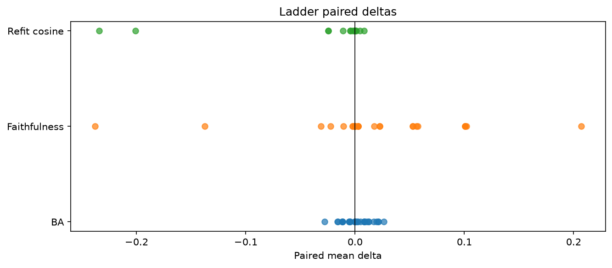

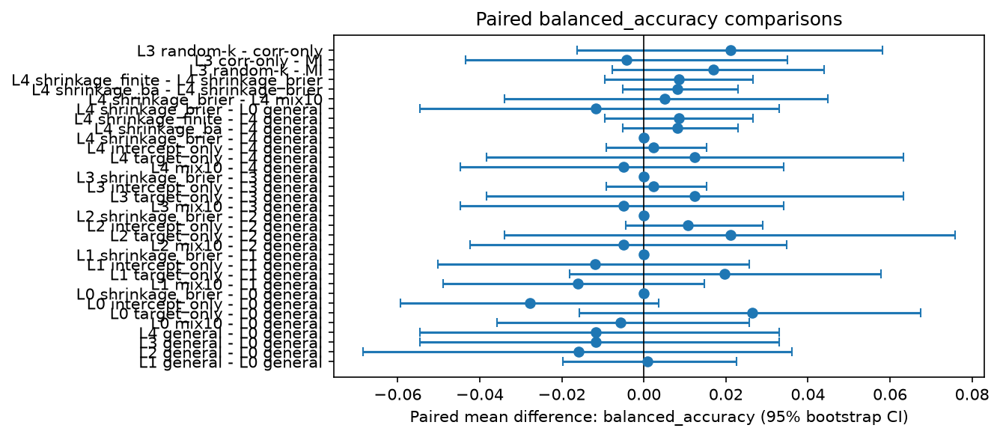

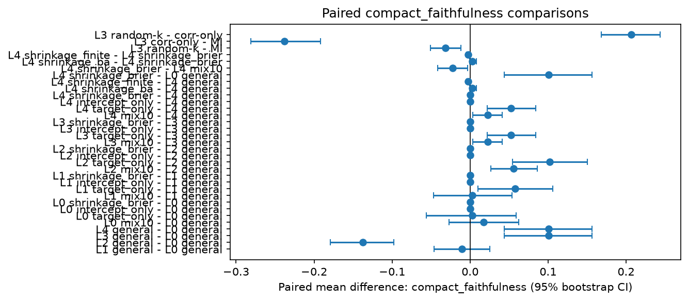

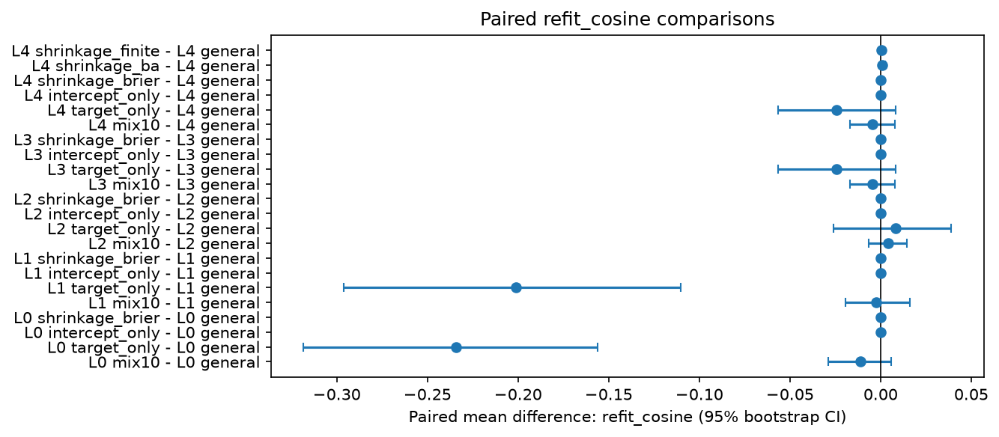

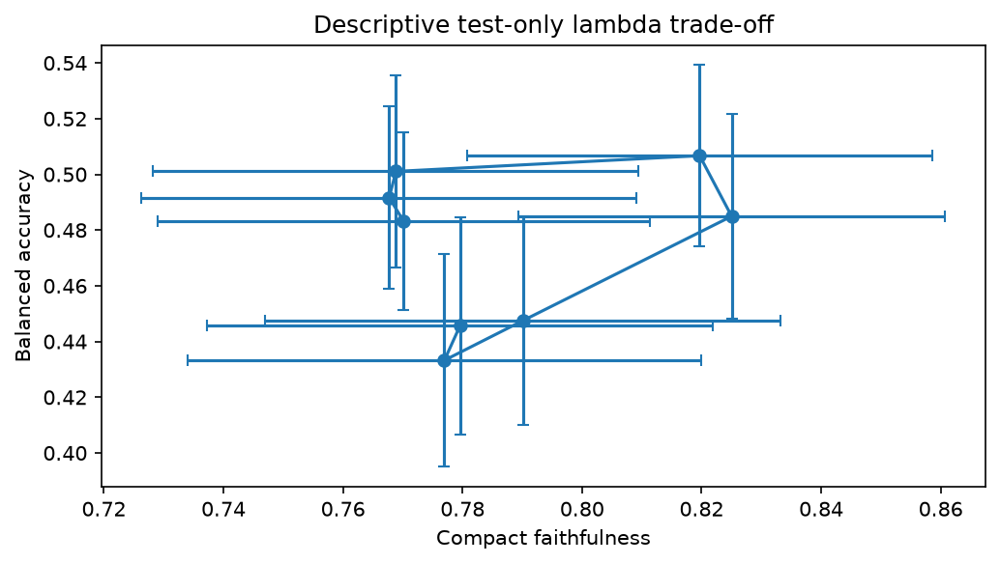

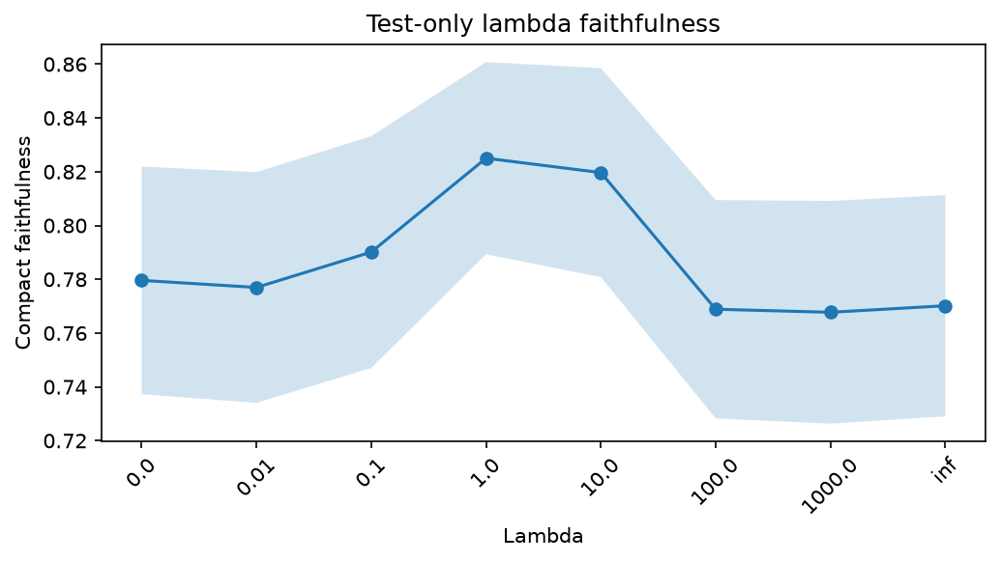

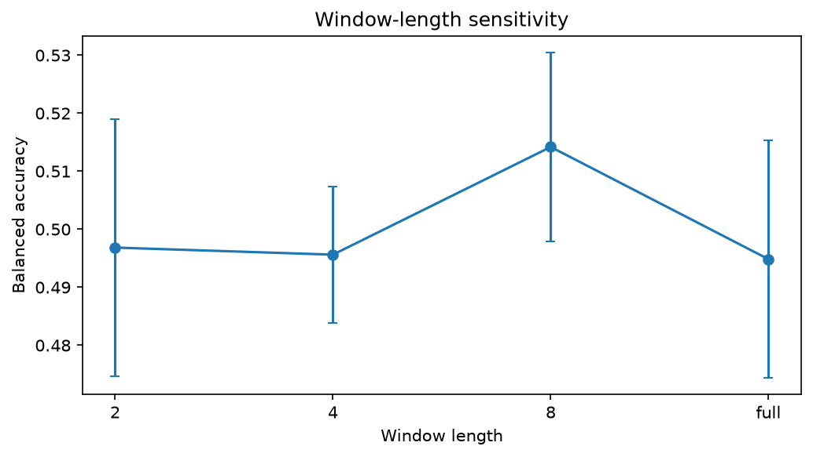

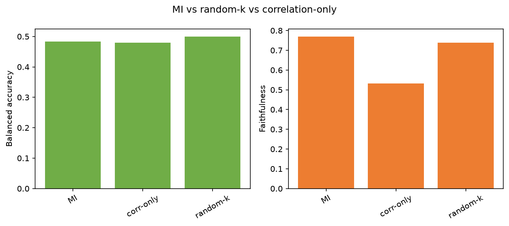

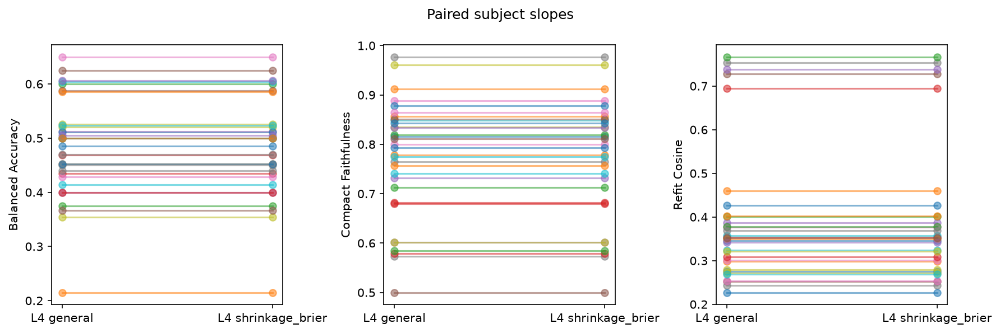

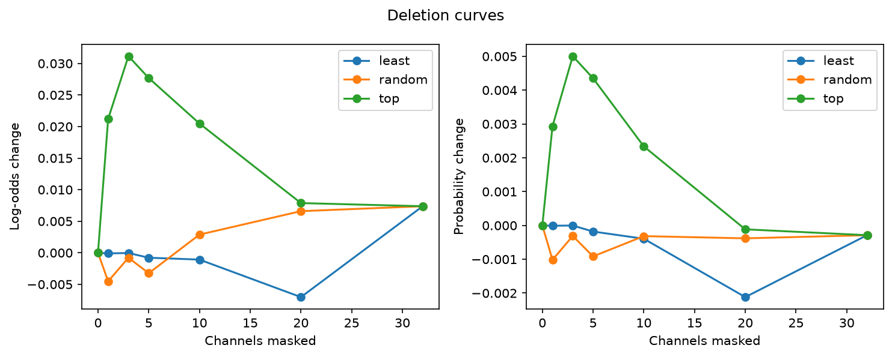

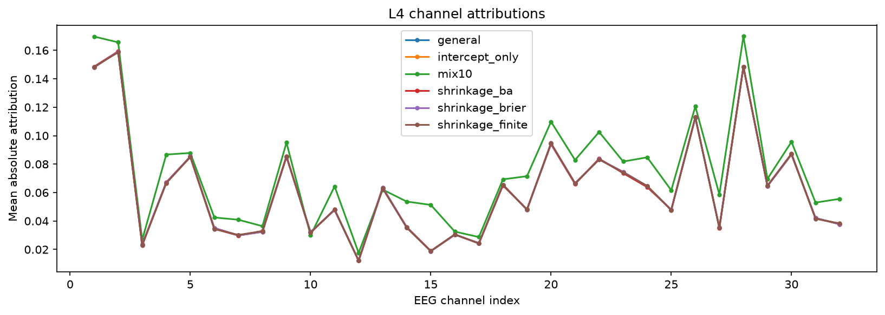

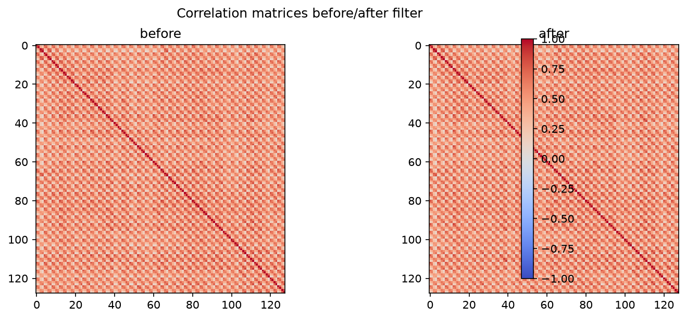

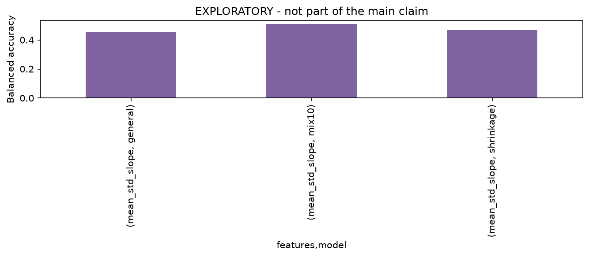

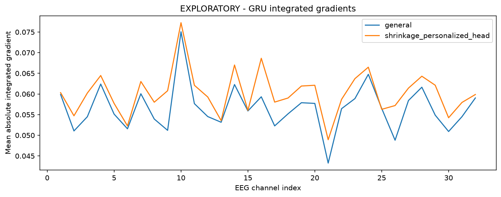

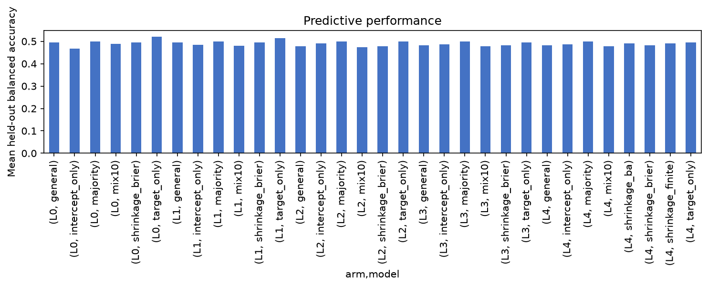

## Exploratory - not part of the main claim

This section reports the window-statistics (mean/std/slope) classifier and optional GRU only. It is separated from the main ladder and does not enter the main inference.

GRU mean held-out balanced accuracy was 0.5129, above the 0.5000 chance reference descriptively; no inferential test against chance was run, and this comparison is exploratory.

| subject | arm | features | model | lambda | balanced_accuracy | macro_f1 | roc_auc | brier | log_loss | tn | fp | fn | tp | compact_faithfulness | ig_completeness_error | deletion_auc | epochs |
| --- | --- | --- | --- | --- | --- | --- | --- | --- | --- | --- | --- | --- | --- | --- | --- | --- | --- |
| 1 | EXPLORATORY - not part of the main claim | mean_std_slope | general | - | 0.34848 | 0.34837 | 0.46465 | 0.25793 | 0.71011 | 3 | 6 | 7 | 4 | - | - | - | - |
| 1 | EXPLORATORY - not part of the main claim | mean_std_slope | mix10 | - | 0.45960 | 0.44862 | 0.45455 | 0.27627 | 0.75047 | 5 | 4 | 7 | 4 | - | - | - | - |
| 1 | EXPLORATORY - not part of the main claim | mean_std_slope | shrinkage | 1000.00000 | 0.44949 | 0.44862 | 0.48485 | 0.25923 | 0.71301 | 4 | 5 | 6 | 5 | - | - | - | - |
| 1 | EXPLORATORY - not part of the main claim | - | general | - | 0.50505 | 0.50000 | 0.50505 | 0.25323 | 0.69954 | 5 | 4 | 6 | 5 | 0.46072 | 0.00221 | 0.09457 | 2.00000 |
| 1 | EXPLORATORY - not part of the main claim | - | shrinkage_personalized_head | - | 0.42424 | 0.37500 | 0.55556 | 0.25389 | 0.70093 | 6 | 3 | 9 | 2 | 0.41305 | 0.00316 | 0.08819 | 2.00000 |
| 2 | EXPLORATORY - not part of the main claim | mean_std_slope | general | - | 0.50000 | 0.47917 | 0.50000 | 0.25048 | 0.69405 | 3 | 3 | 7 | 7 | - | - | - | - |
| 2 | EXPLORATORY - not part of the main claim | mean_std_slope | mix10 | - | 0.58333 | 0.53964 | 0.73810 | 0.23827 | 0.66938 | 4 | 2 | 7 | 7 | - | - | - | - |
| 2 | EXPLORATORY - not part of the main claim | mean_std_slope | shrinkage | inf | 0.50000 | 0.47917 | 0.50000 | 0.25048 | 0.69405 | 3 | 3 | 7 | 7 | - | - | - | - |
| 2 | EXPLORATORY - not part of the main claim | - | general | - | 0.57143 | 0.56044 | 0.59524 | 0.23225 | 0.65668 | 3 | 3 | 5 | 9 | 0.31956 | 0.00422 | 0.16690 | 3.00000 |
| 2 | EXPLORATORY - not part of the main claim | - | shrinkage_personalized_head | - | 0.61905 | 0.58333 | 0.65476 | 0.23936 | 0.67170 | 4 | 2 | 6 | 8 | 0.38185 | 0.00476 | 0.12288 | 3.00000 |
| 3 | EXPLORATORY - not part of the main claim | mean_std_slope | general | - | 0.30000 | 0.27083 | 0.37000 | 0.26846 | 0.73052 | 5 | 5 | 9 | 1 | - | - | - | - |
| 3 | EXPLORATORY - not part of the main claim | mean_std_slope | mix10 | - | 0.55000 | 0.54887 | 0.56000 | 0.25804 | 0.71019 | 5 | 5 | 4 | 6 | - | - | - | - |
| 3 | EXPLORATORY - not part of the main claim | mean_std_slope | shrinkage | 1000.00000 | 0.30000 | 0.27083 | 0.37000 | 0.26803 | 0.72965 | 5 | 5 | 9 | 1 | - | - | - | - |
| 3 | EXPLORATORY - not part of the main claim | - | general | - | 0.55000 | 0.53964 | 0.55000 | 0.24796 | 0.68920 | 4 | 6 | 3 | 7 | 0.45379 | 0.00666 | 0.11856 | 3.00000 |
| 3 | EXPLORATORY - not part of the main claim | - | shrinkage_personalized_head | - | 0.60000 | 0.56044 | 0.58000 | 0.24536 | 0.68495 | 3 | 7 | 1 | 9 | 0.43097 | 0.00651 | 0.16009 | 3.00000 |
| 4 | EXPLORATORY - not part of the main claim | mean_std_slope | general | - | 0.37500 | 0.29293 | 0.35938 | 0.27519 | 0.74479 | 4 | 12 | 2 | 2 | - | - | - | - |
| 4 | EXPLORATORY - not part of the main claim | mean_std_slope | mix10 | - | 0.56250 | 0.43734 | 0.68750 | 0.26359 | 0.72670 | 6 | 10 | 1 | 3 | - | - | - | - |
| 4 | EXPLORATORY - not part of the main claim | mean_std_slope | shrinkage | inf | 0.37500 | 0.29293 | 0.35938 | 0.27519 | 0.74479 | 4 | 12 | 2 | 2 | - | - | - | - |
| 4 | EXPLORATORY - not part of the main claim | - | general | - | 0.40625 | 0.19192 | 0.32812 | 0.29679 | 0.78786 | 1 | 15 | 1 | 3 | -0.17113 | 0.00842 | 0.15213 | 1.00000 |
| 4 | EXPLORATORY - not part of the main claim | - | shrinkage_personalized_head | - | 0.40625 | 0.19192 | 0.42188 | 0.30683 | 0.80887 | 1 | 15 | 1 | 3 | -0.01781 | 0.01115 | 0.16328 | 1.00000 |
| 5 | EXPLORATORY - not part of the main claim | mean_std_slope | general | - | 0.60000 | 0.59596 | 0.54000 | 0.25041 | 0.69406 | 5 | 5 | 3 | 7 | - | - | - | - |
| 5 | EXPLORATORY - not part of the main claim | mean_std_slope | mix10 | - | 0.45000 | 0.43734 | 0.46000 | 0.26978 | 0.73333 | 3 | 7 | 4 | 6 | - | - | - | - |
| 5 | EXPLORATORY - not part of the main claim | mean_std_slope | shrinkage | 1000.00000 | 0.55000 | 0.53964 | 0.53000 | 0.25105 | 0.69532 | 4 | 6 | 3 | 7 | - | - | - | - |
| 5 | EXPLORATORY - not part of the main claim | - | general | - | 0.55000 | 0.52000 | 0.59000 | 0.24482 | 0.68253 | 3 | 7 | 2 | 8 | 0.23206 | 0.00418 | 0.15660 | 1.00000 |
| 5 | EXPLORATORY - not part of the main claim | - | shrinkage_personalized_head | - | 0.50000 | 0.40476 | 0.58000 | 0.25422 | 0.70195 | 1 | 9 | 1 | 9 | 0.28032 | 0.00597 | 0.15857 | 1.00000 |
| 6 | EXPLORATORY - not part of the main claim | mean_std_slope | general | - | 0.50000 | 0.45055 | 0.42188 | 0.34410 | 0.96038 | 2 | 2 | 8 | 8 | - | - | - | - |
| 6 | EXPLORATORY - not part of the main claim | mean_std_slope | mix10 | - | 0.15625 | 0.20000 | 0.12500 | 0.46420 | 1.23727 | 0 | 4 | 11 | 5 | - | - | - | - |
| 6 | EXPLORATORY - not part of the main claim | mean_std_slope | shrinkage | inf | 0.50000 | 0.45055 | 0.42188 | 0.34410 | 0.96038 | 2 | 2 | 8 | 8 | - | - | - | - |
| 6 | EXPLORATORY - not part of the main claim | - | general | - | 0.62500 | 0.52000 | 0.70312 | 0.23689 | 0.66687 | 3 | 1 | 8 | 8 | 0.33283 | 0.00489 | 0.14151 | 4.00000 |
| 6 | EXPLORATORY - not part of the main claim | - | shrinkage_personalized_head | - | 0.62500 | 0.65714 | 0.57812 | 0.21030 | 0.61319 | 1 | 3 | 0 | 16 | 0.06410 | 0.00457 | 0.14462 | 4.00000 |
| 7 | EXPLORATORY - not part of the main claim | mean_std_slope | general | - | 0.58333 | 0.53964 | 0.65476 | 0.31336 | 0.84581 | 4 | 2 | 7 | 7 | - | - | - | - |
| 7 | EXPLORATORY - not part of the main claim | mean_std_slope | mix10 | - | 0.54762 | 0.49495 | 0.47619 | 0.36128 | 1.00376 | 4 | 2 | 8 | 6 | - | - | - | - |
| 7 | EXPLORATORY - not part of the main claim | mean_std_slope | shrinkage | inf | 0.58333 | 0.53964 | 0.65476 | 0.31336 | 0.84581 | 4 | 2 | 7 | 7 | - | - | - | - |
| 7 | EXPLORATORY - not part of the main claim | - | general | - | 0.53571 | 0.52000 | 0.53571 | 0.25306 | 0.69936 | 3 | 3 | 6 | 8 | 0.46610 | 0.00445 | 0.16663 | 2.00000 |
| 7 | EXPLORATORY - not part of the main claim | - | shrinkage_personalized_head | - | 0.48810 | 0.48718 | 0.42857 | 0.25137 | 0.69627 | 2 | 4 | 5 | 9 | 0.34550 | 0.00534 | 0.19135 | 2.00000 |
| 8 | EXPLORATORY - not part of the main claim | mean_std_slope | general | - | 0.35859 | 0.34837 | 0.42424 | 0.32804 | 0.87829 | 4 | 5 | 8 | 3 | - | - | - | - |
| 8 | EXPLORATORY - not part of the main claim | mean_std_slope | mix10 | - | 0.52525 | 0.47917 | 0.46465 | 0.32304 | 0.95637 | 7 | 2 | 8 | 3 | - | - | - | - |
| 8 | EXPLORATORY - not part of the main claim | mean_std_slope | shrinkage | inf | 0.35859 | 0.34837 | 0.42424 | 0.32804 | 0.87829 | 4 | 5 | 8 | 3 | - | - | - | - |
| 8 | EXPLORATORY - not part of the main claim | - | general | - | 0.62121 | 0.60114 | 0.49495 | 0.24864 | 0.69057 | 3 | 6 | 1 | 10 | 0.41168 | 0.00335 | 0.10426 | 2.00000 |
| 8 | EXPLORATORY - not part of the main claim | - | shrinkage_personalized_head | - | 0.57576 | 0.56044 | 0.50505 | 0.25042 | 0.69423 | 3 | 6 | 2 | 9 | 0.43939 | 0.00342 | 0.09964 | 2.00000 |
| 9 | EXPLORATORY - not part of the main claim | mean_std_slope | general | - | 0.62500 | 0.60000 | 0.62500 | 0.23376 | 0.65887 | 6 | 6 | 2 | 6 | - | - | - | - |
| 9 | EXPLORATORY - not part of the main claim | mean_std_slope | mix10 | - | 0.64583 | 0.64194 | 0.70833 | 0.21336 | 0.61882 | 8 | 4 | 3 | 5 | - | - | - | - |
| 9 | EXPLORATORY - not part of the main claim | mean_std_slope | shrinkage | inf | 0.62500 | 0.60000 | 0.62500 | 0.23376 | 0.65887 | 6 | 6 | 2 | 6 | - | - | - | - |
| 9 | EXPLORATORY - not part of the main claim | - | general | - | 0.39583 | 0.33504 | 0.46875 | 0.26161 | 0.71656 | 2 | 10 | 3 | 5 | 0.43427 | 0.00632 | 0.12308 | 2.00000 |
| 9 | EXPLORATORY - not part of the main claim | - | shrinkage_personalized_head | - | 0.56250 | 0.54887 | 0.58333 | 0.25019 | 0.69320 | 6 | 6 | 3 | 5 | 0.45986 | 0.00285 | 0.11837 | 2.00000 |
| 10 | EXPLORATORY - not part of the main claim | mean_std_slope | general | - | 0.25758 | 0.24812 | 0.20202 | 0.27167 | 0.73677 | 2 | 9 | 6 | 3 | - | - | - | - |
| 10 | EXPLORATORY - not part of the main claim | mean_std_slope | mix10 | - | 0.65152 | 0.64912 | 0.62626 | 0.24207 | 0.67720 | 7 | 4 | 3 | 6 | - | - | - | - |
| 10 | EXPLORATORY - not part of the main claim | mean_std_slope | shrinkage | 1000.00000 | 0.30303 | 0.30000 | 0.18182 | 0.26927 | 0.73190 | 3 | 8 | 6 | 3 | - | - | - | - |
| 10 | EXPLORATORY - not part of the main claim | - | general | - | 0.54545 | 0.40476 | 0.44444 | 0.25674 | 0.70658 | 1 | 10 | 0 | 9 | 0.29374 | 0.00486 | 0.11782 | 2.00000 |
| 10 | EXPLORATORY - not part of the main claim | - | shrinkage_personalized_head | - | 0.47980 | 0.41333 | 0.61616 | 0.24891 | 0.69091 | 2 | 9 | 2 | 7 | 0.31535 | 0.00439 | 0.12886 | 2.00000 |
| 11 | EXPLORATORY - not part of the main claim | mean_std_slope | general | - | 0.44505 | 0.43734 | 0.43956 | 0.25956 | 0.71243 | 3 | 4 | 7 | 6 | - | - | - | - |
| 11 | EXPLORATORY - not part of the main claim | mean_std_slope | mix10 | - | 0.69780 | 0.64912 | 0.63736 | 0.23842 | 0.66993 | 6 | 1 | 6 | 7 | - | - | - | - |
| 11 | EXPLORATORY - not part of the main claim | mean_std_slope | shrinkage | inf | 0.44505 | 0.43734 | 0.43956 | 0.25956 | 0.71243 | 3 | 4 | 7 | 6 | - | - | - | - |
| 11 | EXPLORATORY - not part of the main claim | - | general | - | 0.49451 | 0.46667 | 0.63736 | 0.23129 | 0.65548 | 1 | 6 | 2 | 11 | 0.23248 | 0.00717 | 0.15350 | 1.00000 |
| 11 | EXPLORATORY - not part of the main claim | - | shrinkage_personalized_head | - | 0.65934 | 0.60000 | 0.58242 | 0.24323 | 0.68031 | 6 | 1 | 7 | 6 | 0.33873 | 0.00413 | 0.17671 | 1.00000 |
| 12 | EXPLORATORY - not part of the main claim | mean_std_slope | general | - | 0.57143 | 0.56044 | 0.53571 | 0.24518 | 0.68344 | 3 | 3 | 5 | 9 | - | - | - | - |
| 12 | EXPLORATORY - not part of the main claim | mean_std_slope | mix10 | - | 0.52381 | 0.39394 | 0.55952 | 0.27035 | 0.73459 | 5 | 1 | 11 | 3 | - | - | - | - |
| 12 | EXPLORATORY - not part of the main claim | mean_std_slope | shrinkage | 1000.00000 | 0.53571 | 0.52000 | 0.51190 | 0.24590 | 0.68488 | 3 | 3 | 6 | 8 | - | - | - | - |
| 12 | EXPLORATORY - not part of the main claim | - | general | - | 0.47619 | 0.46667 | 0.58333 | 0.23560 | 0.66413 | 1 | 5 | 3 | 11 | 0.06978 | 0.00383 | 0.12966 | 3.00000 |
| 12 | EXPLORATORY - not part of the main claim | - | shrinkage_personalized_head | - | 0.48810 | 0.33504 | 0.60714 | 0.26354 | 0.72155 | 5 | 1 | 12 | 2 | 0.28069 | 0.00505 | 0.17856 | 3.00000 |
| 13 | EXPLORATORY - not part of the main claim | mean_std_slope | general | - | 0.30000 | 0.30000 | 0.40000 | 0.26171 | 0.71599 | 3 | 7 | 7 | 3 | - | - | - | - |
| 13 | EXPLORATORY - not part of the main claim | mean_std_slope | mix10 | - | 0.50000 | 0.47917 | 0.44000 | 0.30944 | 0.87193 | 7 | 3 | 7 | 3 | - | - | - | - |
| 13 | EXPLORATORY - not part of the main claim | mean_std_slope | shrinkage | inf | 0.30000 | 0.30000 | 0.40000 | 0.26171 | 0.71599 | 3 | 7 | 7 | 3 | - | - | - | - |
| 13 | EXPLORATORY - not part of the main claim | - | general | - | 0.35000 | 0.25926 | 0.19000 | 0.28461 | 0.76324 | 0 | 10 | 3 | 7 | 0.23768 | 0.00538 | 0.12048 | 3.00000 |
| 13 | EXPLORATORY - not part of the main claim | - | shrinkage_personalized_head | - | 0.25000 | 0.24812 | 0.18000 | 0.27146 | 0.73630 | 3 | 7 | 8 | 2 | 0.15498 | 0.00413 | 0.09003 | 3.00000 |
| 14 | EXPLORATORY - not part of the main claim | mean_std_slope | general | - | 0.46970 | 0.43734 | 0.52525 | 0.26286 | 0.72026 | 3 | 8 | 3 | 6 | - | - | - | - |
| 14 | EXPLORATORY - not part of the main claim | mean_std_slope | mix10 | - | 0.44949 | 0.44862 | 0.41414 | 0.29142 | 0.78585 | 5 | 6 | 5 | 4 | - | - | - | - |
| 14 | EXPLORATORY - not part of the main claim | mean_std_slope | shrinkage | inf | 0.46970 | 0.43734 | 0.52525 | 0.26286 | 0.72026 | 3 | 8 | 3 | 6 | - | - | - | - |
| 14 | EXPLORATORY - not part of the main claim | - | general | - | 0.54545 | 0.40476 | 0.69697 | 0.24845 | 0.69007 | 1 | 10 | 0 | 9 | 0.34382 | 0.00253 | 0.11009 | 3.00000 |
| 14 | EXPLORATORY - not part of the main claim | - | shrinkage_personalized_head | - | 0.59091 | 0.48718 | 0.61616 | 0.25299 | 0.69998 | 2 | 9 | 0 | 9 | 0.38044 | 0.00612 | 0.12375 | 3.00000 |
| 15 | EXPLORATORY - not part of the main claim | mean_std_slope | general | - | 0.49495 | 0.49495 | 0.52525 | 0.25558 | 0.70478 | 4 | 5 | 5 | 6 | - | - | - | - |
| 15 | EXPLORATORY - not part of the main claim | mean_std_slope | mix10 | - | 0.40404 | 0.40000 | 0.46465 | 0.27433 | 0.74514 | 4 | 5 | 7 | 4 | - | - | - | - |
| 15 | EXPLORATORY - not part of the main claim | mean_std_slope | shrinkage | inf | 0.49495 | 0.49495 | 0.52525 | 0.25558 | 0.70478 | 4 | 5 | 5 | 6 | - | - | - | - |
| 15 | EXPLORATORY - not part of the main claim | - | general | - | 0.36364 | 0.28571 | 0.33333 | 0.27262 | 0.73892 | 0 | 9 | 3 | 8 | 0.36271 | 0.00673 | 0.17137 | 2.00000 |
| 15 | EXPLORATORY - not part of the main claim | - | shrinkage_personalized_head | - | 0.43939 | 0.43734 | 0.41414 | 0.26003 | 0.71311 | 3 | 6 | 5 | 6 | 0.38139 | 0.00948 | 0.17415 | 2.00000 |
| 16 | EXPLORATORY - not part of the main claim | mean_std_slope | general | - | 0.58791 | 0.54887 | 0.57143 | 0.27712 | 0.75838 | 6 | 7 | 2 | 5 | - | - | - | - |
| 16 | EXPLORATORY - not part of the main claim | mean_std_slope | mix10 | - | 0.66484 | 0.64194 | 0.61538 | 0.25990 | 0.72096 | 8 | 5 | 2 | 5 | - | - | - | - |
| 16 | EXPLORATORY - not part of the main claim | mean_std_slope | shrinkage | inf | 0.58791 | 0.54887 | 0.57143 | 0.27712 | 0.75838 | 6 | 7 | 2 | 5 | - | - | - | - |
| 16 | EXPLORATORY - not part of the main claim | - | general | - | 0.50549 | 0.37500 | 0.28571 | 0.28540 | 0.76530 | 2 | 11 | 1 | 6 | 0.47004 | 0.00294 | 0.10277 | 4.00000 |
| 16 | EXPLORATORY - not part of the main claim | - | shrinkage_personalized_head | - | 0.43956 | 0.40000 | 0.31868 | 0.27031 | 0.73416 | 4 | 9 | 3 | 4 | 0.42492 | 0.00316 | 0.11280 | 4.00000 |
| 17 | EXPLORATORY - not part of the main claim | mean_std_slope | general | - | 0.40000 | 0.37500 | 0.45000 | 0.27898 | 0.75569 | 6 | 4 | 8 | 2 | - | - | - | - |
| 17 | EXPLORATORY - not part of the main claim | mean_std_slope | mix10 | - | 0.60000 | 0.59596 | 0.57000 | 0.26443 | 0.73086 | 7 | 3 | 5 | 5 | - | - | - | - |
| 17 | EXPLORATORY - not part of the main claim | mean_std_slope | shrinkage | inf | 0.40000 | 0.37500 | 0.45000 | 0.27898 | 0.75569 | 6 | 4 | 8 | 2 | - | - | - | - |
| 17 | EXPLORATORY - not part of the main claim | - | general | - | 0.50000 | 0.45055 | 0.53000 | 0.25424 | 0.70170 | 2 | 8 | 2 | 8 | 0.36290 | 0.00393 | 0.15142 | 3.00000 |
| 17 | EXPLORATORY - not part of the main claim | - | shrinkage_personalized_head | - | 0.50000 | 0.33333 | 0.52000 | 0.25189 | 0.69685 | 0 | 10 | 0 | 10 | 0.35296 | 0.00370 | 0.12342 | 3.00000 |
| 18 | EXPLORATORY - not part of the main claim | mean_std_slope | general | - | 0.50000 | 0.47917 | 0.36000 | 0.26370 | 0.72098 | 3 | 7 | 3 | 7 | - | - | - | - |
| 18 | EXPLORATORY - not part of the main claim | mean_std_slope | mix10 | - | 0.50000 | 0.50000 | 0.47000 | 0.25905 | 0.71153 | 5 | 5 | 5 | 5 | - | - | - | - |
| 18 | EXPLORATORY - not part of the main claim | mean_std_slope | shrinkage | inf | 0.50000 | 0.47917 | 0.36000 | 0.26370 | 0.72098 | 3 | 7 | 3 | 7 | - | - | - | - |
| 18 | EXPLORATORY - not part of the main claim | - | general | - | 0.55000 | 0.53964 | 0.63000 | 0.23896 | 0.67052 | 4 | 6 | 3 | 7 | 0.39355 | 0.00660 | 0.13941 | 2.00000 |
| 18 | EXPLORATORY - not part of the main claim | - | shrinkage_personalized_head | - | 0.60000 | 0.52381 | 0.72000 | 0.23256 | 0.65641 | 2 | 8 | 0 | 10 | 0.28113 | 0.00889 | 0.16741 | 2.00000 |
| 19 | EXPLORATORY - not part of the main claim | mean_std_slope | general | - | 0.41667 | 0.30667 | 0.31250 | 0.27227 | 0.73816 | 6 | 2 | 11 | 1 | - | - | - | - |
| 19 | EXPLORATORY - not part of the main claim | mean_std_slope | mix10 | - | 0.45833 | 0.37500 | 0.31250 | 0.30777 | 0.81392 | 6 | 2 | 10 | 2 | - | - | - | - |
| 19 | EXPLORATORY - not part of the main claim | mean_std_slope | shrinkage | 1000.00000 | 0.41667 | 0.30667 | 0.23958 | 0.27313 | 0.73994 | 6 | 2 | 11 | 1 | - | - | - | - |
| 19 | EXPLORATORY - not part of the main claim | - | general | - | 0.52083 | 0.46667 | 0.43750 | 0.24985 | 0.69292 | 1 | 7 | 1 | 11 | 0.36538 | 0.00233 | 0.10732 | 2.00000 |
| 19 | EXPLORATORY - not part of the main claim | - | shrinkage_personalized_head | - | 0.41667 | 0.33333 | 0.40625 | 0.25509 | 0.70381 | 0 | 8 | 2 | 10 | 0.31030 | 0.00342 | 0.12870 | 2.00000 |
| 20 | EXPLORATORY - not part of the main claim | mean_std_slope | general | - | 0.56250 | 0.54887 | 0.54167 | 0.24901 | 0.69116 | 5 | 3 | 6 | 6 | - | - | - | - |
| 20 | EXPLORATORY - not part of the main claim | mean_std_slope | mix10 | - | 0.56250 | 0.54887 | 0.51042 | 0.25330 | 0.69978 | 5 | 3 | 6 | 6 | - | - | - | - |
| 20 | EXPLORATORY - not part of the main claim | mean_std_slope | shrinkage | 1000.00000 | 0.62500 | 0.60000 | 0.54167 | 0.24898 | 0.69110 | 6 | 2 | 6 | 6 | - | - | - | - |
| 20 | EXPLORATORY - not part of the main claim | - | general | - | 0.41667 | 0.41333 | 0.45833 | 0.25329 | 0.69993 | 2 | 6 | 5 | 7 | 0.20763 | 0.00571 | 0.19596 | 3.00000 |
| 20 | EXPLORATORY - not part of the main claim | - | shrinkage_personalized_head | - | 0.47917 | 0.47917 | 0.48958 | 0.25501 | 0.70254 | 3 | 5 | 5 | 7 | 0.28068 | 0.00762 | 0.23271 | 3.00000 |
| 21 | EXPLORATORY - not part of the main claim | mean_std_slope | general | - | 0.50000 | 0.49495 | 0.46000 | 0.25020 | 0.69356 | 6 | 4 | 6 | 4 | - | - | - | - |
| 21 | EXPLORATORY - not part of the main claim | mean_std_slope | mix10 | - | 0.50000 | 0.49495 | 0.47000 | 0.25254 | 0.69828 | 6 | 4 | 6 | 4 | - | - | - | - |
| 21 | EXPLORATORY - not part of the main claim | mean_std_slope | shrinkage | 1000.00000 | 0.50000 | 0.47917 | 0.46000 | 0.25076 | 0.69466 | 7 | 3 | 7 | 3 | - | - | - | - |
| 21 | EXPLORATORY - not part of the main claim | - | general | - | 0.40000 | 0.28571 | 0.55000 | 0.25108 | 0.69514 | 0 | 10 | 2 | 8 | 0.24198 | 0.00709 | 0.13075 | 4.00000 |
| 21 | EXPLORATORY - not part of the main claim | - | shrinkage_personalized_head | - | 0.40000 | 0.34066 | 0.41000 | 0.25765 | 0.70849 | 1 | 9 | 3 | 7 | 0.02242 | 0.00593 | 0.14922 | 4.00000 |
| 22 | EXPLORATORY - not part of the main claim | mean_std_slope | general | - | 0.29293 | 0.29293 | 0.31313 | 0.25623 | 0.70561 | 4 | 7 | 7 | 2 | - | - | - | - |
| 22 | EXPLORATORY - not part of the main claim | mean_std_slope | mix10 | - | 0.51010 | 0.43574 | 0.54545 | 0.24743 | 0.68801 | 10 | 1 | 8 | 1 | - | - | - | - |
| 22 | EXPLORATORY - not part of the main claim | mean_std_slope | shrinkage | 100.00000 | 0.55051 | 0.54887 | 0.38384 | 0.25484 | 0.70289 | 6 | 5 | 4 | 5 | - | - | - | - |
| 22 | EXPLORATORY - not part of the main claim | - | general | - | 0.67172 | 0.64194 | 0.68687 | 0.23916 | 0.67125 | 5 | 6 | 1 | 8 | 0.39557 | 0.01262 | 0.12326 | 1.00000 |
| 22 | EXPLORATORY - not part of the main claim | - | shrinkage_personalized_head | - | 0.70707 | 0.70000 | 0.68687 | 0.23320 | 0.65948 | 7 | 4 | 2 | 7 | 0.35231 | 0.01013 | 0.14244 | 1.00000 |
| 23 | EXPLORATORY - not part of the main claim | mean_std_slope | general | - | 0.28125 | 0.27083 | 0.26562 | 0.27088 | 0.73551 | 1 | 3 | 11 | 5 | - | - | - | - |
| 23 | EXPLORATORY - not part of the main claim | mean_std_slope | mix10 | - | 0.34375 | 0.34066 | 0.25000 | 0.28896 | 0.77129 | 1 | 3 | 9 | 7 | - | - | - | - |
| 23 | EXPLORATORY - not part of the main claim | mean_std_slope | shrinkage | inf | 0.28125 | 0.27083 | 0.26562 | 0.27088 | 0.73551 | 1 | 3 | 11 | 5 | - | - | - | - |
| 23 | EXPLORATORY - not part of the main claim | - | general | - | 0.46875 | 0.46667 | 0.46875 | 0.25865 | 0.71160 | 1 | 3 | 5 | 11 | 0.46140 | 0.00708 | 0.15399 | 1.00000 |
| 23 | EXPLORATORY - not part of the main claim | - | shrinkage_personalized_head | - | 0.59375 | 0.56113 | 0.51562 | 0.24515 | 0.68339 | 2 | 2 | 5 | 11 | 0.42045 | 0.00506 | 0.11238 | 1.00000 |
| 24 | EXPLORATORY - not part of the main claim | mean_std_slope | general | - | 0.40000 | 0.40000 | 0.50000 | 0.25127 | 0.69567 | 4 | 6 | 6 | 4 | - | - | - | - |
| 24 | EXPLORATORY - not part of the main claim | mean_std_slope | mix10 | - | 0.40000 | 0.37500 | 0.41000 | 0.25802 | 0.70942 | 6 | 4 | 8 | 2 | - | - | - | - |
| 24 | EXPLORATORY - not part of the main claim | mean_std_slope | shrinkage | 1000.00000 | 0.40000 | 0.40000 | 0.49000 | 0.25146 | 0.69606 | 4 | 6 | 6 | 4 | - | - | - | - |
| 24 | EXPLORATORY - not part of the main claim | - | general | - | 0.55000 | 0.43574 | 0.71000 | 0.23801 | 0.66885 | 1 | 9 | 0 | 10 | 0.33157 | 0.00537 | 0.09636 | 2.00000 |
| 24 | EXPLORATORY - not part of the main claim | - | shrinkage_personalized_head | - | 0.50000 | 0.49495 | 0.56000 | 0.24189 | 0.67675 | 4 | 6 | 4 | 6 | 0.32297 | 0.00357 | 0.10533 | 2.00000 |
| 25 | EXPLORATORY - not part of the main claim | mean_std_slope | general | - | 0.51515 | 0.49495 | 0.70707 | 0.24105 | 0.67515 | 6 | 3 | 7 | 4 | - | - | - | - |
| 25 | EXPLORATORY - not part of the main claim | mean_std_slope | mix10 | - | 0.53535 | 0.45055 | 0.53535 | 0.25459 | 0.70237 | 8 | 1 | 9 | 2 | - | - | - | - |
| 25 | EXPLORATORY - not part of the main claim | mean_std_slope | shrinkage | 1000.00000 | 0.56061 | 0.54887 | 0.68687 | 0.24121 | 0.67549 | 6 | 3 | 6 | 5 | - | - | - | - |
| 25 | EXPLORATORY - not part of the main claim | - | general | - | 0.55556 | 0.46667 | 0.47475 | 0.25596 | 0.70632 | 1 | 8 | 0 | 11 | 0.23450 | 0.00751 | 0.14570 | 1.00000 |
| 25 | EXPLORATORY - not part of the main claim | - | shrinkage_personalized_head | - | 0.44949 | 0.44862 | 0.43434 | 0.26158 | 0.71705 | 4 | 5 | 6 | 5 | 0.28781 | 0.00829 | 0.19210 | 1.00000 |
| 26 | EXPLORATORY - not part of the main claim | mean_std_slope | general | - | 0.46667 | 0.45055 | 0.48000 | 0.24924 | 0.69162 | 2 | 3 | 7 | 8 | - | - | - | - |
| 26 | EXPLORATORY - not part of the main claim | mean_std_slope | mix10 | - | 0.56667 | 0.52000 | 0.73333 | 0.24339 | 0.67991 | 3 | 2 | 7 | 8 | - | - | - | - |
| 26 | EXPLORATORY - not part of the main claim | mean_std_slope | shrinkage | 100.00000 | 0.60000 | 0.56044 | 0.61333 | 0.24830 | 0.68975 | 3 | 2 | 6 | 9 | - | - | - | - |
| 26 | EXPLORATORY - not part of the main claim | - | general | - | 0.53333 | 0.53125 | 0.68000 | 0.20922 | 0.60970 | 1 | 4 | 2 | 13 | 0.53968 | 0.00699 | 0.09896 | 4.00000 |
| 26 | EXPLORATORY - not part of the main claim | - | shrinkage_personalized_head | - | 0.53333 | 0.52381 | 0.70667 | 0.21047 | 0.60917 | 2 | 3 | 5 | 10 | 0.55273 | 0.01161 | 0.12392 | 4.00000 |
| 27 | EXPLORATORY - not part of the main claim | mean_std_slope | general | - | 0.59524 | 0.50000 | 0.75000 | 0.24968 | 0.69251 | 5 | 1 | 9 | 5 | - | - | - | - |
| 27 | EXPLORATORY - not part of the main claim | mean_std_slope | mix10 | - | 0.50000 | 0.41176 | 0.33333 | 0.24220 | 0.67758 | 0 | 6 | 0 | 14 | - | - | - | - |
| 27 | EXPLORATORY - not part of the main claim | mean_std_slope | shrinkage | 100.00000 | 0.48810 | 0.48718 | 0.29762 | 0.25580 | 0.70479 | 2 | 4 | 5 | 9 | - | - | - | - |
| 27 | EXPLORATORY - not part of the main claim | - | general | - | 0.54762 | 0.53125 | 0.32143 | 0.23372 | 0.66062 | 1 | 5 | 1 | 13 | 0.28986 | 0.00399 | 0.11876 | 5.00000 |
| 27 | EXPLORATORY - not part of the main claim | - | shrinkage_personalized_head | - | 0.50000 | 0.41176 | 0.34524 | 0.22858 | 0.65197 | 0 | 6 | 0 | 14 | 0.39762 | 0.00345 | 0.13039 | 5.00000 |
| 28 | EXPLORATORY - not part of the main claim | mean_std_slope | general | - | 0.49495 | 0.49495 | 0.46465 | 0.25304 | 0.69924 | 4 | 5 | 5 | 6 | - | - | - | - |
| 28 | EXPLORATORY - not part of the main claim | mean_std_slope | mix10 | - | 0.38384 | 0.37500 | 0.40404 | 0.26797 | 0.72968 | 2 | 7 | 5 | 6 | - | - | - | - |
| 28 | EXPLORATORY - not part of the main claim | mean_std_slope | shrinkage | 1000.00000 | 0.49495 | 0.49495 | 0.45455 | 0.25344 | 0.70004 | 4 | 5 | 5 | 6 | - | - | - | - |
| 28 | EXPLORATORY - not part of the main claim | - | general | - | 0.45455 | 0.33333 | 0.66667 | 0.23721 | 0.66690 | 0 | 9 | 1 | 10 | 0.23570 | 0.01259 | 0.18248 | 4.00000 |
| 28 | EXPLORATORY - not part of the main claim | - | shrinkage_personalized_head | - | 0.50000 | 0.35484 | 0.66667 | 0.23917 | 0.67041 | 0 | 9 | 0 | 11 | 0.31325 | 0.01414 | 0.19120 | 4.00000 |
| 29 | EXPLORATORY - not part of the main claim | mean_std_slope | general | - | 0.25758 | 0.24812 | 0.21212 | 0.27180 | 0.73715 | 2 | 9 | 6 | 3 | - | - | - | - |
| 29 | EXPLORATORY - not part of the main claim | mean_std_slope | mix10 | - | 0.55051 | 0.54887 | 0.57576 | 0.24481 | 0.68246 | 6 | 5 | 4 | 5 | - | - | - | - |
| 29 | EXPLORATORY - not part of the main claim | mean_std_slope | shrinkage | 100.00000 | 0.30303 | 0.30000 | 0.23232 | 0.26697 | 0.72726 | 3 | 8 | 6 | 3 | - | - | - | - |
| 29 | EXPLORATORY - not part of the main claim | - | general | - | 0.46970 | 0.43734 | 0.46465 | 0.25364 | 0.70016 | 3 | 8 | 3 | 6 | 0.42129 | 0.00336 | 0.12724 | 2.00000 |
| 29 | EXPLORATORY - not part of the main claim | - | shrinkage_personalized_head | - | 0.43434 | 0.34066 | 0.51515 | 0.26541 | 0.72349 | 1 | 10 | 2 | 7 | 0.35171 | 0.00471 | 0.14472 | 2.00000 |
| 30 | EXPLORATORY - not part of the main claim | mean_std_slope | general | - | 0.41667 | 0.41333 | 0.33333 | 0.28183 | 0.76000 | 2 | 4 | 7 | 7 | - | - | - | - |
| 30 | EXPLORATORY - not part of the main claim | mean_std_slope | mix10 | - | 0.41667 | 0.41333 | 0.35714 | 0.33576 | 0.90994 | 2 | 4 | 7 | 7 | - | - | - | - |
| 30 | EXPLORATORY - not part of the main claim | mean_std_slope | shrinkage | inf | 0.41667 | 0.41333 | 0.33333 | 0.28183 | 0.76000 | 2 | 4 | 7 | 7 | - | - | - | - |
| 30 | EXPLORATORY - not part of the main claim | - | general | - | 0.40476 | 0.40476 | 0.35714 | 0.25192 | 0.69781 | 1 | 5 | 5 | 9 | 0.19966 | 0.00400 | 0.18932 | 7.00000 |
| 30 | EXPLORATORY - not part of the main claim | - | shrinkage_personalized_head | - | 0.46429 | 0.39394 | 0.42857 | 0.23366 | 0.66067 | 0 | 6 | 1 | 13 | 0.19634 | 0.00457 | 0.22256 | 7.00000 |
| 31 | EXPLORATORY - not part of the main claim | mean_std_slope | general | - | 0.40476 | 0.40476 | 0.38095 | 0.25333 | 0.69992 | 1 | 5 | 5 | 9 | - | - | - | - |
| 31 | EXPLORATORY - not part of the main claim | mean_std_slope | mix10 | - | 0.41667 | 0.41333 | 0.35714 | 0.26327 | 0.72017 | 2 | 4 | 7 | 7 | - | - | - | - |
| 31 | EXPLORATORY - not part of the main claim | mean_std_slope | shrinkage | 1000.00000 | 0.40476 | 0.40476 | 0.35714 | 0.25303 | 0.69930 | 1 | 5 | 5 | 9 | - | - | - | - |
| 31 | EXPLORATORY - not part of the main claim | - | general | - | 0.48810 | 0.48718 | 0.47619 | 0.24801 | 0.68909 | 2 | 4 | 5 | 9 | 0.34320 | 0.00455 | 0.13167 | 1.00000 |
| 31 | EXPLORATORY - not part of the main claim | - | shrinkage_personalized_head | - | 0.53571 | 0.52000 | 0.61905 | 0.23924 | 0.67118 | 3 | 3 | 6 | 8 | 0.30878 | 0.00651 | 0.14245 | 1.00000 |
| 32 | EXPLORATORY - not part of the main claim | mean_std_slope | general | - | 0.70000 | 0.67033 | 0.59000 | 0.23571 | 0.66400 | 10 | 0 | 6 | 4 | - | - | - | - |
| 32 | EXPLORATORY - not part of the main claim | mean_std_slope | mix10 | - | 0.65000 | 0.64912 | 0.66000 | 0.24823 | 0.69192 | 6 | 4 | 3 | 7 | - | - | - | - |
| 32 | EXPLORATORY - not part of the main claim | mean_std_slope | shrinkage | inf | 0.70000 | 0.67033 | 0.59000 | 0.23571 | 0.66400 | 10 | 0 | 6 | 4 | - | - | - | - |
| 32 | EXPLORATORY - not part of the main claim | - | general | - | 0.50000 | 0.33333 | 0.61000 | 0.25073 | 0.69439 | 0 | 10 | 0 | 10 | 0.29853 | 0.00414 | 0.13610 | 1.00000 |
| 32 | EXPLORATORY - not part of the main claim | - | shrinkage_personalized_head | - | 0.65000 | 0.64194 | 0.57000 | 0.24898 | 0.69154 | 5 | 5 | 2 | 8 | 0.35451 | 0.00440 | 0.19236 | 1.00000 |

## Failures and analyses not computed

Completed subject folds: 32; failed subject folds: 0. A failed-fold count changes the analysis N and is not imputed. See failures.csv and exploratory_failures.csv.

| analysis | status | reason |
| --- | --- | --- |
| LOSO prediction | computed |  |
| Compact faithfulness | computed |  |
| Stability refits | computed |  |
| Stability refits across all rungs | computed |  |
| Deletion curves | computed |  |
| MI/random-k/correlation controls | computed |  |
| Window sensitivity | computed |  |
| Exploratory 4a | computed |  |
| Exploratory GRU | computed |  |
| Shuffled-channel attribution control | computed |  |
| Shuffled calibration-label control | computed |  |
| Predictive-preservation bound | computed |  |
| Pseudo-target lambda selection | computed |  |
| Exact SHAP additivity assertion | computed |  |
| Paired inferential statistics | computed |  |
| Per-subject correlation matrices | computed |  |
| Subject fold failures | computed |  |

The officially released DEAP provenance was not independently verified. Each target has only 20 test trials; LOSO folds share source subjects. Faithfulness depends on the channel-masking assumption and weight concentration and is not physiological causality. MI is pooled across source subjects. Near-chance predictive performance limits explanation value. The −0.03 predictive-preservation margin is illustrative and pre-chosen, not tuned.

The workbook provenance was not independently verified. The exploratory GRU can overfit the small trial set; its results are explicitly outside the main claim.

### Failed folds

_No rows were produced._

Exploratory failures:

_No rows were produced._

## Reviewer questions

**Why MI rather than differential entropy?** For a band-limited Gaussian, differential entropy is monotonic in log power; MI gives a distinct label-relevance criterion.

**Why windows rather than baseline correction?** Short baselines can include movement artifacts; window aggregation can reduce the impact of isolated noisy intervals.

**Why shrinkage?** It limits changes to the source decision rule when target calibration labels are few.

**Why top five?** It is the pre-specified compact explanation size; full and compact faithfulness are reported separately.

**Why is subject normalization adaptation?** It uses target calibration-period features, even without their labels.

## Reproducibility

See config.json for seeds, subjects, package versions, feature-cache references, and hashes. `run.log` records runtime and warnings; the CSV files are the source of every reported statistic.
